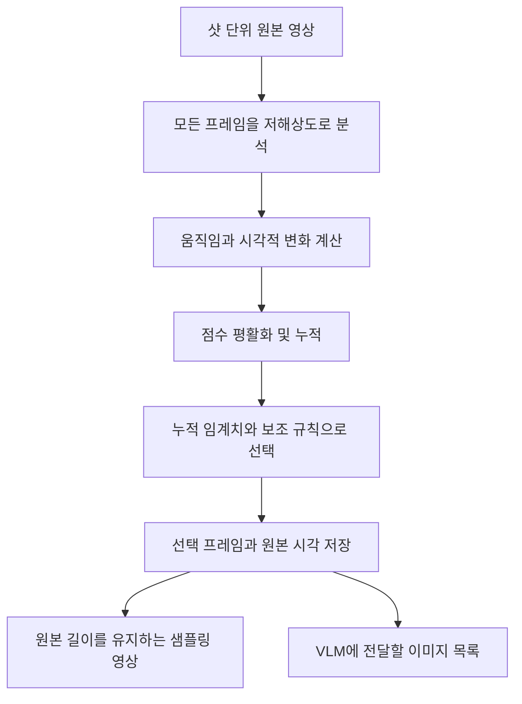

# Adaptive Sampling 설명서

> 영상의 내용 변화를 따라가면서, VLM에 전달할 프레임 수를 줄이는 방법

이 문서는 `03_adaptive_sampling`의 현재 구현을 설명합니다.
앞부분은 **무엇을 하고 왜 하는지**, 뒷부분은 **어떤 계산과 규칙으로 동작하는지**를 다룹니다.

## 1. 무엇을 하려는가?

영상의 모든 프레임을 VLM에 전달하면, 거의 같은 이미지도 반복해서 분석하게 됩니다.
예를 들어 타이틀이 가만히 보이는 5초 동안에는 많은 프레임이 필요하지 않습니다.
반대로 사람이 뛰거나 물체가 빠르게 움직이는 5초 동안에는 더 많은 프레임이 필요합니다.

이 작업의 목표는 **내용을 파악하는 데 필요한 대표 프레임을 영상의 변화에 맞춰 선택하는 것**입니다.

| 영상 상태 | 원하는 동작 |
|---|---|
| 거의 같은 화면이 계속됨 | 드문드문 선택 |
| 천천히 자세나 배경이 바뀜 | 변화가 쌓이면 선택 |
| 빠른 동작이 이어짐 | 자주 선택 |
| 갑자기 화면이 크게 바뀜 | 즉시 선택 |

입력은 앞 단계에서 분리한 샷 단위 영상들입니다. 각 샷을 독립적으로 처리합니다.
출력은 선택한 이미지, 원본 시각 정보, 그리고 **원본과 재생 길이가 같은 샘플링 영상**입니다.

내용을 충분히 남기는 것이 설계 목표입니다. 다만 현재 방법은 움직임과 이미지 차이를 측정하므로,
모든 의미 있는 행동을 보존한다고 보장하지는 않습니다.

## 2. 핵심 아이디어: 변화가 쌓이면 한 장을 고른다

### 2.1. 변화량을 담는 통을 생각하면 쉽다

프레임이 하나 들어올 때마다 이전 프레임과 얼마나 달라졌는지 측정합니다.
그 변화량을 통에 조금씩 담고, 통이 일정 수준 이상 차면 현재 프레임을 선택합니다.
선택한 뒤에는 통을 비우고 다시 시작합니다.

```text
작은 변화 → 조금 누적 → 조금 누적 → 조금 누적 → 선택
큰 변화   → 많이 누적 → 선택
거의 정지 → 거의 누적되지 않음 → 일정 시간이 지나면 선택
```

따라서 영상마다, 또 같은 영상 안에서도 샘플 간격이 달라집니다.

- 정적인 구간에서는 통이 천천히 차므로 샘플 간격이 길어집니다.
- 움직임이 많은 구간에서는 통이 빨리 차므로 샘플 간격이 짧아집니다.
- 같은 자세로 돌아오는 동작도 중간의 변화가 계속 누적됩니다.

**샘플링 빈도는 변화가 임계치에 도달하는 속도에 따라 결정됩니다.**

### 2.2. 무엇을 ‘변화’라고 보는가?

현재 구현은 세 가지 신호를 함께 사용합니다.

| 신호 | 쉽게 말하면 | 필요한 이유 |
|---|---|---|
| 카메라 보정 후 움직임 | 화면 속 물체가 얼마나 이동했는가 | 사람·물체의 동작을 따라가기 위해 |
| 시각적 변화 | 색상·밝기·모양이 얼마나 달라졌는가 | 페이드나 밝기 변화도 반영하기 위해 |
| 카메라 움직임 일부 | 화면 전체가 얼마나 이동했는가 | 카메라 이동으로 드러나는 내용도 반영하기 위해 |

예를 들어 카메라가 옆으로 움직이면 배경 전체가 이동합니다.
이때 모든 이동을 피사체의 동작으로 계산하면 샘플이 과하게 늘어날 수 있습니다.
그래서 화면 전체에 공통적인 움직임을 먼저 추정해 보정합니다.

그러면서도 카메라 이동 자체를 약하게 반영하고, 마지막 선택 이미지와 현재 이미지도 비교합니다.
카메라가 움직여 새로운 내용이 보이면 다시 샘플을 선택할 수 있습니다.

### 2.3. 누적만으로 놓칠 수 있는 경우를 보완한다

누적치가 임계치에 도달하는 것을 기다리는 동안 중요한 변화가 지나갈 수 있습니다.
반대로 정적인 장면에서는 오랫동안 샘플이 선택되지 않을 수도 있습니다.
이를 보완하기 위해 다음 규칙을 함께 사용합니다.

- **첫 이미지와 마지막 이미지는 항상 선택합니다.**
- 기본 설정에서는 **약 1초마다 최소 한 번**은 새 이미지를 선택합니다.
- 인접 프레임 사이에 큰 변화가 생기면 즉시 선택합니다.
- 마지막으로 선택한 이미지와 현재 이미지가 충분히 달라졌으면 선택합니다.
- 일반적인 선택에는 최소 시간 간격을 두어 너무 많은 프레임이 뽑히는 것을 제한합니다.

## 3. 전체 처리 과정



### 3.1. 가벼운 분석을 먼저 한다

원본의 모든 프레임을 디코딩하되, 변화 계산은 폭 256px의 작은 이미지에서 수행합니다.
이 단계에서는 샘플 사이에 있는 원본 프레임도 분석합니다.

즉, 전체 프레임을 저렴하게 훑은 뒤 비싼 VLM 분석에 사용할 프레임을 고르는 구조입니다.
VLM 입력을 줄이기 위한 사전 처리 비용은 별도로 발생합니다.

### 3.2. 선택된 이미지는 원본 해상도로 저장한다

작은 이미지는 선택 여부를 판단하는 데 사용합니다.
실제 출력 이미지와 샘플링 영상은 원본 해상도를 사용합니다.
JPEG와 H.264로 저장하므로 픽셀 값이 무손실로 보존되는 것은 아닙니다.

### 3.3. 선택 시각을 함께 저장한다

이미지만 넘기면 VLM 분석 결과를 원본 영상의 어느 시점에 연결해야 하는지 알기 어렵습니다.
따라서 각 샘플에 다음 두 좌표를 함께 저장합니다.

- 해당 부분영상 안에서의 프레임 번호와 시간
- 전체 원본 영상 안에서의 프레임 번호와 시간

전체 원본 기준 좌표는 입력 목록의 샷 시작 프레임 정보를 사용합니다.

## 4. 프레임을 줄여도 영상 길이는 유지한다

### 4.1. 선택한 이미지를 다음 샘플 시점까지 보여준다

원본에서 0.0초, 0.4초, 1.1초의 이미지를 선택했다고 가정해 봅시다.

| 원본 시간 구간 | 출력에 보이는 이미지 |
|---|---|
| 0.0초 이상, 0.4초 미만 | 0.0초에서 선택한 이미지 |
| 0.4초 이상, 1.1초 미만 | 0.4초에서 선택한 이미지 |
| 1.1초부터 다음 선택 시점까지 | 1.1초에서 선택한 이미지 |

이렇게 **이미지마다 유지 시간을 다르게 지정**합니다.
영상의 시간 구간은 모두 남고, 샘플 사이의 시각적 변화가 대표 이미지로 대체됩니다.

따라서 샘플링 영상은 원본보다 움직임이 끊겨 보일 수 있지만 재생 속도나 전체 길이는 바뀌지 않습니다.

### 4.2. 분석용 영상과 비교 영상의 역할

| 출력 | 용도 | 저장 방식 |
|---|---|---|
| `sampled.mp4` | 샘플링 결과 재생 | 선택 프레임만 저장하는 VFR 영상 |
| `frames/`와 `samples.json` | VLM 입력 및 시간 매핑 | 선택 이미지와 시각 정보 |
| `comparison.mp4` | 샷별 육안 비교 | 원본 FPS로 원본/샘플링 결과를 나란히 표시 |
| `comparison_full.mp4` | 전체 흐름의 육안 비교 | 샷별 비교 영상을 입력 순서대로 연결 |

VFR은 프레임마다 표시 간격이 다른 영상 형식입니다.
비교 영상은 원본 FPS로 만들어 같은 대표 이미지가 여러 프레임 동안 반복됩니다.

VLM에는 `frames/`의 이미지를 `samples.json` 순서대로 전달하는 방식이 명확합니다.
영상 전처리기가 MP4에서 일정 FPS로 이미지를 다시 추출하면, 유지 중인 이미지가 중복 입력될 수 있습니다.

---

## 5. 상세 계산: 변화 점수를 어떻게 만드는가?

이 절부터 현재 구현의 수식을 설명합니다. 코드 위치는 [sampling.py](sampling.py)입니다.

### 5.1. 기호 정의

| 기호 | 의미 |
|---|---|
| $t$ | 현재 프레임 번호 |
| $k$ | 마지막으로 선택한 프레임 번호 |
| $F$ | 원본 FPS |
| $\Delta t=1/F$ | 원본 프레임 사이의 시간 |
| $I_t$ | 분석용으로 축소한 현재 이미지 |
| $p$ | 이미지의 픽셀 위치 |
| $D$ | 분석 이미지의 대각선 길이 |
| $M_t$ | 카메라 보정 후 움직임 점수 |
| $V_t$ | 카메라 보정 후 시각적 변화 점수 |
| $C_t$ | 카메라 움직임 점수 |
| $A_t$ | 마지막 선택 이후의 누적 변화량 |

### 5.2. Optical flow와 카메라 보정

Optical flow는 이전 이미지의 각 위치가 현재 이미지에서 어느 방향으로 얼마나 이동했는지 추정한 벡터입니다.
현재 구현은 Farneback 방법을 사용합니다.

$$
u_t(p)=\text{이전 프레임에서 현재 프레임까지의 이동 벡터}
$$

그다음 여러 위치의 이동을 함께 설명하는 전역 변환 $T_t$를 RANSAC으로 추정합니다.
이 변환은 평행이동, 회전, 균일한 확대/축소를 포함합니다.

$$
g_t(p)=T_t(p)-p
$$

카메라 움직임으로 설명되는 성분을 빼면 잔여 움직임이 됩니다.

$$
r_t(p)=u_t(p)-g_t(p)
$$

여기서 잔여 움직임은 피사체 움직임의 근사치입니다.
카메라 모델이 설명하지 못하는 배경 변화나 추정 오차도 포함될 수 있습니다.

카메라 변환은 충분한 수의 일치점이 화면 여러 영역에 퍼져 있을 때만 사용합니다.
추정이 조건을 만족하지 못하면 항등 변환을 사용하여 보정을 생략합니다.

### 5.3. 움직임 점수

$$
M_t=\max\left(0,\frac{Q_{85}(\|r_t\|)}{D}-0.0002\right)
$$

계산의 의미는 다음과 같습니다.

1. 잔여 이동 벡터의 길이를 구합니다.
2. 움직임이 큰 부분을 반영하도록 85백분위수를 구합니다.
3. 이미지 대각선 길이로 나누어 크기를 정규화합니다.
4. 작은 추정 오차를 줄이기 위해 0.0002를 빼고, 음수는 0으로 만듭니다.

$Q_{85}$는 단순한 화면 전체 통계 하나가 아닙니다.
화면 전체의 85백분위수와 4×4 각 영역의 85백분위수 중 가장 큰 값을 사용합니다.
이렇게 하면 작은 영역의 움직임도 점수에 반영할 수 있습니다.

### 5.4. 시각적 변화 점수

이전 이미지를 카메라 변환으로 정렬한 이미지를 $I_{t-1}^{\mathrm{aligned}}$라고 하겠습니다.
정렬한 이미지와 현재 이미지의 RGB 차이를 계산합니다.

$$
e_t(p)=\frac{1}{3\times255}
\sum_{c\in\{R,G,B\}}
\left|I_t(p,c)-I_{t-1}^{\mathrm{aligned}}(p,c)\right|
$$

픽셀별 차이를 모아 다음과 같이 점수를 만듭니다.

$$
V_t=\max\left(0,\mathcal{R}(e_t)-0.002\right)
$$

$\mathcal{R}$은 다음 두 값 중 큰 값입니다.

- 전체 유효 영역에서 구한 평균 차이
- 4×4 영역 중 차이가 큰 상위 3개 영역 평균의 평균

카메라 정렬 후 서로 겹치는 영역을 사용합니다.
이 점수는 색상과 밝기 차이에 반응하므로, 움직임 추정만으로 설명하기 어려운 페이드도 반영할 수 있습니다.
현재는 RGB 절대 차이를 사용하며, SSIM이나 의미 임베딩을 계산하지 않습니다.

### 5.5. 카메라 움직임 점수

$$
C_t=\frac{P_{90}(\|g_t\|)}{D}
$$

카메라 변환으로 설명되는 이동 크기의 90백분위수를 이미지 대각선 길이로 나눈 값입니다.
카메라 움직임에 작은 가중치를 주기 위한 별도 항입니다.

### 5.6. 세 점수의 결합

$$
\boxed{s_t=2.0M_t+1.0V_t+0.15C_t}
$$

| 항목 | 기본 가중치 |
|---|---:|
| 잔여 움직임 $M_t$ | 2.0 |
| 시각적 변화 $V_t$ | 1.0 |
| 카메라 움직임 $C_t$ | 0.15 |

각 항의 실제 값 범위가 다르므로, 가중치만으로 최종 기여 비율을 판단할 수는 없습니다.
이 값들은 현재 구현의 초기 설정이며, 학습이나 최적화로 도출한 값은 아닙니다.

### 5.7. 평활화와 누적

매 프레임의 점수에는 작은 추정 오차나 순간적인 변동이 섞일 수 있습니다.
현재 변화에 바로 반응하면서도 변동을 완화하도록 지수이동평균을 함께 사용합니다.

먼저 평활화 계수를 구합니다.

$$
\alpha=1-\exp\left(-\frac{\Delta t}{\tau}\right),\qquad \tau=0.12\text{초}
$$

초당 변화율의 이동평균을 $h_t$라고 하면:

$$
h_t=(1-\alpha)h_{t-1}+\alpha\frac{s_t}{\Delta t}
$$

현재 변화와 평활화한 변화를 절반씩 섞습니다.

$$
q_t=0.5s_t+0.5h_t\Delta t
$$

이 값을 누적합니다.

$$
\boxed{A_t=A_{t-1}+q_t}
$$

일반적인 누적 임계치는 다음과 같습니다.

$$
\boxed{A_t\ge\theta,\qquad\theta=0.08}
$$

이 임계치는 ‘화면의 8%가 바뀌었다’는 뜻이 아닙니다.
여러 종류의 변화량을 가중합하고 누적한 점수의 기준값입니다.

프레임이 선택되면 누적치는 0으로 초기화하며 임계치를 초과한 값도 이월하지 않습니다.
이동평균 $h_t$는 유지합니다. 새로운 샷에서는 두 상태 모두 0으로 초기화합니다.
별도의 상향/하향 임계치를 사용하는 hysteresis는 현재 구현에 없습니다.

## 6. 상세 선택 규칙: 언제 프레임을 선택하는가?

### 6.1. 누적 점수 외에 비교하는 두 가지 차이

보조 규칙에서는 카메라 정렬을 하지 않은 이미지 차이도 사용합니다.

$$
E_{\mathrm{adj}}(t)=\mathcal{R}\left(
\frac{1}{3\times255}\sum_c|I_t(p,c)-I_{t-1}(p,c)|\right)
$$

$$
E_{\mathrm{anchor}}(t)=\mathcal{R}\left(
\frac{1}{3\times255}\sum_c|I_t(p,c)-I_k(p,c)|\right)
$$

- $E_{\mathrm{adj}}$: 바로 이전 프레임과의 차이. 갑작스러운 변화를 찾습니다.
- $E_{\mathrm{anchor}}$: 마지막으로 선택한 이미지와의 차이. 대표 이미지를 교체할 필요가 있는지 판단합니다.

두 점수는 카메라 보정과 작은 차이 차감을 적용하지 않습니다.
따라서 카메라 이동만 있는 구간도 새 내용이 보이면 자주 선택될 수 있습니다.

### 6.2. 조건의 적용 순서

마지막 선택 이후 경과 시간은 다음과 같습니다.

$$
\delta_t=\frac{t-k}{F}
$$

첫 프레임을 선택한 뒤, 각 프레임에 아래 조건을 위에서부터 적용합니다.
먼저 만족한 조건의 사유를 기록하고 현재 프레임을 선택합니다.

| 우선순위 | 기본 설정의 조건 | 기록되는 사유 |
|---|---|---|
| 1 | $E_{\mathrm{adj}}\ge0.25$ | `transient` |
| 2 | $\delta_t\ge1.0$초 | `max_interval` |
| 3 | $\delta_t\ge0.1$초이고 $E_{\mathrm{anchor}}\ge0.18$ | `visual_guard` |
| 4 | $\delta_t\ge0.1$초이고 $A_t\ge0.08$ | `change_budget` |

모든 조건을 만족하지 않으면 선택하지 않고 다음 프레임의 변화를 계속 누적합니다.
처음과 끝은 각각 `first`, `last`로 선택하며, 이미 선택한 마지막 프레임을 중복 추가하지는 않습니다.

`transient`는 최소 간격을 기다리지 않습니다. 급격한 변화가 이어지면 연속 프레임도 선택할 수 있습니다.
따라서 `max_fps`는 모든 선택에 적용되는 절대 상한이 아닙니다.

### 6.3. FPS 설정과 실제 선택 간격

기본 설정은 다음과 같습니다.

- `min_fps = 1`: 최대 유지 간격의 기준을 1초로 설정합니다.
- `max_fps = 10`: 일반 선택의 최소 간격을 0.1초로 설정합니다.

선택할 수 있는 시점은 원본 프레임이 존재하는 시점뿐입니다.
24fps 영상에서 0.1초는 2.4프레임이므로, 일반 선택에는 최소 3프레임이 필요합니다.
즉 일반 선택을 가장 촘촘하게 해도 3프레임마다, 약 8fps로 선택합니다.

아래는 증가량 $q_t$가 일정하다고 가정한 예시입니다.

| 프레임당 누적 증가량 | 동작 | 대략적인 빈도 |
|---:|---|---:|
| 거의 0 | 최대 간격 규칙에 따라 24프레임마다 선택 | 1fps |
| 0.01 | 8프레임 만에 누적치 0.08 도달 | 3fps |
| 0.04 | 2프레임 만에 임계치 도달, 최소 간격 때문에 3프레임째 선택 | 8fps |

실제 결과에는 첫/마지막 프레임, 보조 조건, 변화량의 변동이 함께 반영됩니다.
따라서 최종 샘플 수를 영상 길이로 나눈 평균 FPS는 위 예시와 다를 수 있습니다.

## 7. 시간 보존과 원본 좌표의 계산

원본 프레임 수를 $N$, 선택한 프레임 번호를 $k_0,k_1,\ldots,k_{m-1}$이라고 하겠습니다.
첫 프레임과 마지막 프레임을 선택하므로 $k_0=0$, $k_{m-1}=N-1$입니다.

각 샘플의 원본 시각은 다음과 같습니다.

$$
t_i=\frac{k_i}{F}
$$

마지막 구간의 끝을 표현하기 위해 $k_m=N$이라고 두면, 샘플의 유지 시간은:

$$
d_i=\frac{k_{i+1}-k_i}{F}
$$

모든 유지 시간을 더하면 원본 길이와 같습니다.

$$
\sum_{i=0}^{m-1}d_i=\frac{N}{F}
$$

전체 원본에서 해당 샷의 시작 프레임이 $b$라면:

$$
\text{original\_frame}_i=b+k_i
$$

$$
\text{original\_time\_sec}_i=\frac{b+k_i}{F}
$$

이 정보는 `samples.json`에 저장됩니다.
정확한 좌표 계산에는 정수 프레임 번호와 유리수 문자열로 저장한 FPS를 사용하면 됩니다.
샷과 전체 원본의 FPS는 같아야 합니다.

## 8. 결과를 보고 설정을 조절하는 방법

### 8.1. 현재 Sintel 결과

| 항목 | 결과 |
|---|---:|
| 처리한 부분영상 | 17개 |
| 원본 프레임 수 | 1,253장 |
| 선택 프레임 수 | 279장 |
| 프레임 감소율 | 77.7% |
| 영상 길이 합계 | 52.208333초 |

액션 장면인 `shot_0009`는 50장에서 18장을 선택했고,
타이틀 장면인 `shot_0015`는 141장에서 9장을 선택했습니다.
프레임 감소율은 실제 VLM 연산량이나 추론시간을 측정한 값은 아닙니다.

[전체 비교 영상](outputs/sintel_adaptive/comparison_full.mp4)에서
왼쪽 원본과 오른쪽 샘플링 결과를 함께 보며 동작의 흐름이 충분히 남는지 확인할 수 있습니다.

### 8.2. 조정의 시작점

| 원하는 변화 | 조정할 설정 | 예상 효과 |
|---|---|---|
| 전반적으로 더 촘촘하게 | `change_budget` 낮추기 | 적은 누적 변화에도 선택 |
| 정적인 구간도 더 자주 확인 | `min_fps` 높이기 | 최대 유지 간격 감소 |
| 빠른 동작에서 더 촘촘하게 | `max_fps` 높이기 | 일반 선택의 최소 간격 감소 |
| 대표 이미지와 달라지면 빨리 교체 | `visual_guard` 낮추기 | 마지막 선택 이미지와의 차이에 민감해짐 |
| 갑작스러운 변화에 더 민감하게 | `transient_guard` 낮추기 | 최소 간격을 무시하는 선택 증가 가능 |
| 작은 움직임을 더 세밀하게 분석 | `analysis_width` 높이기 | 분석 비용 증가, 점수 분포도 달라질 수 있음 |

일반 선택의 최소 간격에 이미 도달한 구간에서는 `change_budget`만 낮춰도 샘플 수가 늘지 않을 수 있습니다.

더 촘촘한 설정으로 실행하는 예:

```bash
cd ~/HayeonP/video_analysis/03_adaptive_sampling
./run.sh --input-list inputs/sintel_shots.json \
  --change-budget 0.04 --min-fps 2 --max-fps 12 \
  --output outputs/sintel_dense --comparison
```

출력 폴더가 이미 있으면 새 폴더 이름을 지정해야 합니다.
실행과 입력 형식에 관한 추가 설명은 [README](README.md)에 있습니다.

### 8.3. 결과를 해석할 때의 범위

이 방법은 이미지의 변화를 측정합니다. 의미의 중요도를 직접 판단하지 않습니다.
작은 표정 변화, 짧은 손동작, 작은 글자 변화처럼 점수는 작지만 중요한 사건이 있을 수 있습니다.
카메라 보정도 실제 카메라 운동과 물체 운동을 완벽히 구분하지는 못합니다.

따라서 목적에 맞는 샘플 밀도는 비교 영상을 보고 조정해야 합니다.
특히 행동을 세밀하게 분석하려는 경우에는 넓은 내용 요약보다 촘촘한 설정이 필요할 수 있습니다.

## 부록: 코드와 로그를 따라가려면

| 확인할 내용 | 위치 |
|---|---|
| 기본값 | `sampling.py`의 `Config` |
| 영역별 통계 | `sampling.py`의 `spatial_stat()` |
| Optical flow, 카메라 보정, 시각적 변화 | `sampling.py`의 `motion_features()` |
| 누적과 선택 조건 | `sampling.py`의 `Selector.push()` |
| 마지막 프레임 보존 | `sampling.py`의 `Selector.finish()` |
| 샷별 분석·이미지 저장·비교 영상 | `adaptive_sampling.py` |
| VFR 영상의 PTS와 유지 시간 | `media.py`의 `VideoWriter` |
| 전체 비교 영상 연결 | `join_comparisons.py` |
| 각 원본 프레임의 점수와 선택 사유 | 결과 폴더의 `motion.csv` |
| 선택 프레임과 원본 시간 매핑 | 결과 폴더의 `samples.json` |

카메라 추정의 주요 조건은 다음과 같습니다.

- 분석 이미지에서 6px 간격으로 질감 있는 점을 사용합니다.
- RANSAC의 위치 오차 허용치는 1.2px입니다.
- 일치점이 최소 12개이고, 일치 비율이 55% 이상이어야 합니다.
- 일치점이 화면 폭의 45%, 높이의 35% 이상에 걸쳐 분포해야 합니다.
- 프레임 간 배율은 0.90~1.10 범위여야 합니다.
- 변환의 이동 성분 크기는 이미지의 긴 변 길이의 20% 미만이어야 합니다.

움직임 통계에는 질감이 있는 픽셀을 사용하고 테두리 4px를 제외합니다.
카메라 정렬 후 시각적 변화에는 유효하게 겹치는 영역을 사용하고 테두리 3px를 제외합니다.
영역별 통계는 유효 픽셀이 12개 이상인 영역에서 계산합니다.
