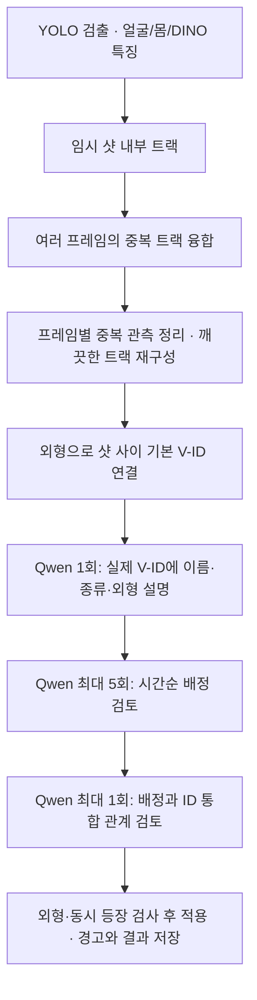

# Anchored 결과 실패 원인과 수정 범위

## 결론

확인한 이전 결과는 동일 대상 매칭이 정상적으로 수행된 결과가 아니었습니다.
전체 기준 목록 생성이 실패한 뒤 **56개 트랙을 모두 별도 미확정 ID로 출력**했습니다.
중복 박스 제거도 0건이었습니다. 이번에 처리 순서와 실패 시 동작을 수정했지만,
**새 분석·테스트는 실행하지 않았으며 실제 정확도 개선은 아직 확인하지 않았습니다.**

## 저장된 결과에서 확인한 사실

대상 결과: `outputs/sintel_anchored/with_qwen/`

| 항목 | 저장된 값 |
| --- | --- |
| 입력 트랙 | 56개 |
| 유효한 기준 목록 항목 | 0개 |
| 매칭된 트랙 | 0개 |
| 미확정 트랙 / 최종 ID | 56개 / 56개 |
| 실제 Qwen 생성 | 2회, 모두 전체 목록 요청 |
| 제거된 중복 관측 | 0개 |

근거: [실행 요약](outputs/sintel_anchored/with_qwen/anchored/summary.json),
[호출 기록](outputs/sintel_anchored/with_qwen/qwen_budget.json),
[중복 처리 기록](outputs/sintel_anchored/with_qwen/duplicate_observations.json).

### 1. 전체 목록 응답이 두 번 모두 검증에 실패

당시 스키마는 `reference_track_ids`를 대상당 최대 4개로 제한했습니다.
첫 응답은 일부 대상에 5~6개, 재시도 응답도 6개를 반환했습니다.
두 응답이 모두 거절되면서 유효 기준 목록이 비었습니다.
호출 기록의 `generated`는 모델이 답을 생성했다는 뜻이며, 응답 검증에 성공했다는 뜻은 아닙니다.

근거: [첫 실패](outputs/sintel_anchored/with_qwen/anchored/overview/failure_1.json),
[두 번째 실패](outputs/sintel_anchored/with_qwen/anchored/overview/failure_2.json).

원문에는 형식 문제 외에 의미 혼합도 있었습니다. 첫 응답은 동일 트랙을 여성과 드래곤의 참고 목록에,
두 번째 응답은 동일 트랙을 얼굴이 가려진 인물과 노인의 참고 목록에 동시에 넣었습니다.
따라서 참고 목록 길이 제한만 완화해 답을 받아들이는 것으로 해결할 수 없습니다.
근거: [첫 응답 원문](outputs/sintel_anchored/with_qwen/review_traces/000001.json),
[두 번째 응답 원문](outputs/sintel_anchored/with_qwen/review_traces/000002.json).

### 2. 실패 후 기본 외형 연결을 사용하지 않음

기준 목록이 비면 샷 사이 연결 없이 트랙마다 미확정 ID를 만들었습니다.
이 때문에 같은 대상도 샷이 바뀌거나 트랙이 끊길 때마다 새 사람·물체처럼 표시되었습니다.
미확정이라는 내부 상태와 정상적으로 매칭을 마친 결과를 충분히 구분해서 알리지도 못했습니다.

### 3. 중복 박스 처리가 전역 매칭 성공에 의존

이전 중복 제거는 이미 같은 ID에 배정된 관측에 적용됐습니다.
중복 박스가 서로 다른 미확정 ID로 남으면 검사 대상으로 만나지 못했습니다.
최종 검토도 고정된 기준 대상 사이의 통합을 지원하지 않아, 처음 갈라진 목록을 복구하기 어려웠습니다.

## 수정한 처리 과정

- **중복을 먼저 정리:** 동일 ID 배정을 기다리지 않고 샷 안의 반복 관측·위치·크기·외형으로 중복을 판단합니다.
- **기본 매칭 보존:** 얼굴·몸·DINO 특징으로 샷 사이 연결을 만든 뒤 Qwen을 호출합니다. JSON 검증 실패 시에도 이 추정을 보존합니다.
- **참고 목록은 코드가 관리:** Qwen은 실제 기본 ID를 사용합니다. 참고 트랙 소속을 임의로 작성하지 않습니다.
- **최종 통합 가능:** 마지막 한 번의 카탈로그 검토에서 분리된 ID의 통합을 제안할 수 있습니다. 외형의 긍정적 근거와 실제 동시 등장 제약을 통과해야 적용합니다.
- **실패를 표시:** `anchored/quality.json`과 결과 상태에 실패·미검토 경고를 남깁니다.
- **호출 상한 유지:** 계획상 최대 7회, 실패·재시도를 포함한 실제 생성은 작업당 최대 8회입니다.

감사 기록은 `observation_fusion.json`, `track_fusion.json`,
`anchored/visual_association.json`, `anchored/quality.json`에 저장합니다.

## 범용성 및 남은 확인

영화 이름, 특정 샷·대상 ID, 등장인물 수, 생물 수를 매칭 규칙으로 넣지 않았습니다.
위 결과 경로와 사례는 실패를 설명하기 위한 기록입니다.
새 처리의 기준은 `fusion`, `visual_association`, `matching` 등 설정에서 조정합니다.

외형 유사도는 추정 근거입니다. 비슷한 옷, 흐린 얼굴, 겹친 생물에서는 잘못 합치거나 여전히 나눌 수 있습니다.
**코드 수정 완료와 실제 영상에서의 정확도 확인은 별개입니다.** 기존 결과는 새 구조의 결과가 아니며,
새 실행에서 인물 연결·생물 구분·중복 박스가 개선되었는지 확인해야 합니다.

실행 방법은 [README](README.md), 이전 측정치는 [과거 개선 기록](EFFICIENT_UPGRADE_REPORT.md)을 참고하세요.
