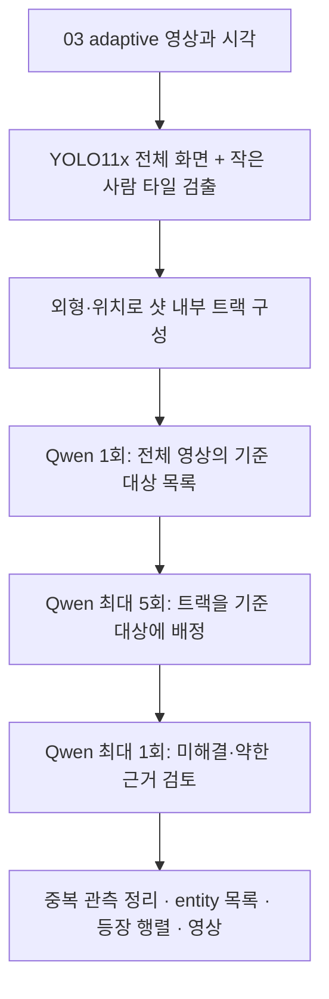

# 04 개선 기록: 기준 대상 먼저 정의하기

> **과거 설계·측정 기록입니다. 현재 구현과 정확도를 설명하는 문서가 아닙니다.**
> 후속 anchored 실행에서 기준 목록 생성이 실패해 56개 트랙이 모두 미확정으로 남았습니다.
> 저장된 실패 근거와 현재 수정 범위는 [Anchored 실패 분석](ANCHORED_FAILURE_REPORT.md),
> 현재 실행 방법은 [README](README.md)를 보세요. 아래 측정치와 당시 설명은 이력으로 보존합니다.

> **후속 범용화 수정:** 아래 실행 측정치와 79개 검사는 이전 코드의 기록입니다.
> 현재 코드는 입력 자동 선택·입력별 출력 경로, `config.default.json`, 화면 대비 크기 기준,
> 약한 단일 관측 기본 보존, 긴 입력의 요청 크기 제한을 추가했습니다.
> 이번 수정 후 테스트·분석은 실행하지 않았습니다. 현재 사용법과 기본값은 [README](README.md)를 참고하세요.
> 기본 출력은 이제 `outputs/<입력폴더이름>_entities`이며 아래 `sintel_anchored`는 이전 설계 경로입니다.

## 1. 현재 상태

**새 기본 구조는 구현했으며, 사용자의 요청에 따라 실제 영상 분석은 추가 실행하지 않았습니다.**
새 결과는 `./run.sh`를 실행하면 `outputs/sintel_anchored`에 생성됩니다.
이 문서에서 중간 실험의 측정치와 최종 코드의 검증 범위를 구분합니다.

## 2. 바꾼 이유와 핵심 컨셉

이전 방식은 샷마다 만든 임시 entity를 누적하고 다시 병합했습니다.
잘못 붙인 분류와 여러 조각 ID가 문맥 기억에 들어가면, 마지막 검토에서도 의미 범주와 실제 개체가 섞였습니다.
Qwen 호출을 늘리는 것만으로 동일성 문제가 해결되지는 않았습니다.

새 방식은 **영상 전체에서 기준 대상을 먼저 정하고, 각 샷의 관측을 그 기준에 연결**합니다.



기준 대상은 짧은 이름, 종류, 안정적인 외형, 참조 트랙으로 구성합니다.
참조 이미지는 비교 근거일 뿐 등장 기록으로 자동 등록하지 않습니다.
각 트랙의 실제 배정이 이루어져야 등장 행렬에 포함됩니다.
기준표 작성 후에는 배치 결과를 참조 이미지에 계속 추가하거나 기준 대상끼리 다시 병합하지 않습니다.

## 3. 검출과 외형 비교

| 역할 | 모델·방법 | 적용 범위 |
|---|---|---|
| 박스 검출 | YOLO11x, 입력 크기 1280 | 선택된 모든 프레임의 전체 화면 |
| 작은 사람 보강 | 필요 프레임에서 최대 6개 타일 | 타일에서 추가하는 사람은 원본 높이 96px 이하 |
| 얼굴 | YuNet → SFace | 얼굴 검출과 품질 조건을 충족한 경우 |
| 인물 외형 | OSNet-AIN x1.0 | 사람 crop |
| 범용 외형 | DINOv2-small | 사람·동물·물체 crop |
| 샷 내부 연결 | 외형 + 위치·속도, Hungarian 일대일 할당 | 샷 경계 안에서만 트랙 생성 |
| 이름·문맥·동일성 | Qwen3-VL-4B-Instruct | 기준표 작성, 배정, 최종 미해결 검토 |

한 번만 검출되고 신뢰도가 0.65 미만인 트랙은 시간상 근거가 부족한 후보로 별도 기록합니다.
이 필터는 오검출을 줄이지만 짧고 약한 실제 대상도 제외할 수 있습니다.
검출 모델의 클래스는 정답으로 취급하지 않습니다. 예를 들어 판타지 생물을 사람이나 다른 동물로 검출했으면 Qwen이 종류를 명시적으로 정정할 수 있습니다.

기준별 외형 후보는 최대 3개를 검색하며, 기준 목록이 8개 이하면 모두 보여 줍니다.
현재 crop에 YOLO의 잘못된 클래스명을 크게 붙이지 않도록 했습니다.
Qwen의 연결에는 외형 근거도 요구합니다. 얼굴이 없다는 사실은 서로 다르다는 증거로 사용하지 않습니다.
유사도 임계값은 초기 휴리스틱이며, 확률이나 검증된 정확도 수치가 아닙니다.

## 4. Qwen 호출과 종료 조건

- 기본 17개 샷: 기준표 1회 + 배치 최대 5회 + 미해결 검토 최대 1회 = 계획상 최대 7회.
- **실제 생성은 작업당 최대 8회**. 응답 형식 오류 재시도와 GPU 메모리 실패도 포함합니다.
- 실제 생성 시작 전에 `qwen_budget.json`을 갱신하므로 중단 후 재개해도 사용 횟수가 유지됩니다.
- 같은 요청의 캐시를 읽는 것은 새 생성이 아닙니다. 예산을 모두 쓴 뒤에도 캐시 재사용은 가능합니다.
- 각 요청 위치에서 최대 2번 시도하며, 마지막 검토용 1회는 예약합니다.
- 처음 보여 주는 대표 트랙은 최대 24개, 마지막 미해결 검토도 최대 24개입니다.
- 대표 트랙은 샷별로 먼저 하나씩 고릅니다. 샷이 24개보다 많으면 영상 처음부터 끝까지 균등하게 포함합니다.
- 비어 있는 배치나 검토할 항목이 없는 마지막 단계는 호출하지 않습니다.
- 예산이나 근거가 부족하면 미확정으로 보존합니다. 추가 쌍별 비교나 역방향 루프를 만들지 않습니다.

이 구현은 Python이 순서와 예산을 관리하는 고정된 처리 과정입니다.
같은 Qwen 모델이 정해진 세 역할을 맡습니다. 스스로 계획을 늘리는 다중 agent 실행기는 아닙니다.

## 5. 서로 다른 대상과 중복 박스

같은 프레임의 서로 다른 대상은 같은 entity로 연결하지 않습니다.
예외는 이미 같은 기준 대상에 배정됐고, 박스 겹침·크기·외형 근거가 함께 맞는 중복 관측입니다.

- 사람: IoU ≥ 0.20, 면적비 ≥ 0.45이고, 몸 유사도 ≥ 0.80 및 DINO ≥ 0.85 또는 고품질 얼굴 유사도 ≥ 0.65.
- 비사람: IoU ≥ 0.60, 면적비 ≥ 0.60, DINO ≥ 0.94.
- 확실한 얼굴 불일치는 같은 옷으로 덮어쓰지 않습니다.
- 큰 생물과 그 안에 포함된 작은 생물처럼 크기가 다른 중첩 박스는 보존합니다.
- 제거한 관측 ID와 수치는 `duplicate_observations.json`에 남깁니다.
- 해결하지 못한 동시 등장 충돌은 트랙별 미확정 ID로 분리해 관측을 유지합니다.

## 6. 실제로 측정한 범위

### 이전 방식과 중간 실험

| 항목 | 이전 sequential 결과 | 중간 efficient 실험 |
|---|---:|---:|
| 실제 Qwen 생성 | 214회 | 합계 8회, 메모리 실패 1회 포함 |
| 완료 실행의 총 경과 시간 | 약 37분 18.83초 | 재개 실행 4분 38.62초 |
| Qwen ON 경과 시간 | 약 36분 17초 | 재개 실행 3분 31.95초 |
| 최종 entity 수 | 31개 | 41개 |

중간 실험은 첫 실행 약 97초 후 메모리 오류가 발생했고, 이후 동일 호출 장부를 유지한 채 재개했습니다.
표의 4분 38.62초는 재개 실행 시간입니다. 첫 실패 실행, 수정 작업, 중간 대기 시간을 포함한 단일 연속 실행 측정치가 아닙니다.
검출·Qwen 입력 설정도 중간에 조정되었으므로 이 수치로 최종 anchored 실행 시간을 보장할 수 없습니다.

**중간 실험의 동일성 매칭은 만족스럽지 않았습니다.**
Qwen이 여러 인물과 장비를 넓은 범주로 묶으려 했고, 제약 검사에서 막힌 제안이 많았습니다.
41개 ID가 나왔다는 것은 성능 개선의 증거가 아닙니다.
이 결과는 `outputs/sintel_efficient`에 남겨 두고, 이를 계기로 기준 대상 구조로 다시 수정했습니다.

### 작은 사람 검출

실제 사막 보행자가 보이는 `shot_0014`의 선택 프레임 구간에서,
기존 YOLO11s는 34개 중 2개 프레임, 새 YOLO11x + 타일 경로는 34개 중 34개 프레임에 사람 박스를 만들었습니다.
이는 해당 구간의 박스 존재 여부 확인이며, 모든 샷의 precision/recall이나 같은 사람으로 매칭되는 정확도를 뜻하지 않습니다.

### 최종 anchored 코드

최종 구조의 실제 Qwen 분석은 **사용자 요청에 따라 실행하지 않았습니다**.
따라서 빨간 머리 여성의 모든 샷 통합, 두 생물의 정확한 분리·통합은 아직 실제 결과로 검증되지 않았습니다.
모델 없는 회귀 검사는 호출 상한, 캐시 재개, 분류 정정, 참조와 관측의 분리, 동시 등장 제약, 중복 박스 처리, 출력 상태 전달을 다룹니다.

최종 검사 결과: **CPU 회귀 테스트 79개 통과**(6.616초).
`run.sh --help`, 수정한 Python 파일의 구문, 뷰어 HTML 내부 JavaScript 구문, 결과가 아직 없는 뷰어 경로도 확인했습니다.
이 검사는 실제 모델의 영상 해석 정확도를 평가하지 않습니다.

```bash
# video_analysis 폴더에서 실행하는 모델 없는 회귀 검사
01_low_freq_event/.venv/bin/python -m unittest discover -s 04_entity_extraction/tests -p 'test_*.py'
```

## 7. 실행과 결과 확인

```bash
cd ~/HayeonP/video_analysis/04_entity_extraction
./run.sh
./visualize.sh
```

VS Code의 Ports에서 5004를 전달하고 `http://localhost:5004`를 엽니다.
기본 분석은 ON/OFF를 각각 저장하고 비교 영상까지 생성합니다.

- 실행 시간: `outputs/sintel_anchored/timing.json`
- 호출 장부: `with_qwen/qwen_budget.json`
- 기준 목록: `with_qwen/anchored/anchors.json`
- 트랙 배정·근거: `with_qwen/anchored/assignments.json`, `assignment_evidence.json`
- 중복 관측 처리: `with_qwen/duplicate_observations.json`
- 최종 목록: `with_qwen/entities.json`
- 샷별 0/1: `with_qwen/entity_shot_presence.csv`
- 시각화: `with_qwen/adaptive_entities_full.mp4`
- OFF/ON 비교: `qwen_comparison_full.mp4`

행렬의 0은 검출·배정 기록이 없다는 뜻입니다. 실제 대상이 영상에 없음을 증명하지 않습니다.
영상은 원본 시간축과 adaptive 표시 유지 구간을 보존하며 무음입니다.

검출 모델 참고: [Ultralytics YOLO11](https://docs.ultralytics.com/models/yolo11/).
타일 검출의 일반적인 접근은 [Ultralytics의 SAHI 가이드](https://docs.ultralytics.com/guides/sahi-tiled-inference/)를 참고할 수 있습니다.
현재 코드는 SAHI 패키지 대신 자체 타일 선택·좌표 변환·중복 정리를 사용합니다.
