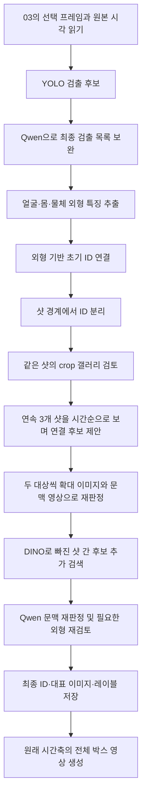

# 04 Entity Extraction 동작 및 실행 시간 리포트

> 이 문서는 이전 `temporal` 버전의 기록입니다. 현재 기본 실행은 `sequential`이며,
> 정방향 기억·독립 역방향·최종 재검토를 수행합니다. [현재 설명서](SEQUENTIAL_MATCHING.md)를 참고하세요.

작성 기준: 2026-10-06 / 당시 기본 실행 `--mode both --qwen-identity temporal` / 시간순 매칭 버전 7.

## 1. 무엇을 하는 작업인가

**여러 짧은 영상에서 등장 대상을 찾고, 같은 대상의 서로 다른 모습을 하나의 ID로 연결하는 작업이다.**

입력은 03 단계에서 이미 adaptive sampling한 샷 영상들이다.
출력은 개체별 대표 이미지·레이블·등장 기록과, 모든 샷을 이어 붙인 bounding box 영상이다.
이 단계에서 영상을 다시 downsampling하지 않는다.

예를 들어 작은 용이 날다가 다음 샷에서 붙잡혀 뒤집히더라도,
같은 용으로 판단되면 같은 ID와 색상을 표시하는 것이 목적이다.
이를 위해 **대상의 외형**과 **앞뒤 장면의 시간적 문맥**을 함께 사용한다.

다만 결과는 자동 추정이다. 현재 결과에서도 초기 비행 모습이 별도 ID로 남아 있으며,
모든 개체의 정답 매칭을 완성했다는 의미는 아니다.

## 2. 전체 흐름



위 흐름은 Qwen ON 경로다. 기본 명령은 OFF 경로도 별도로 실행하고 비교 영상을 만든다.

| 구분 | Qwen OFF | Qwen ON, 기본 temporal |
|---|---|---|
| 검출 | YOLO 결과 | YOLO 후보를 Qwen이 보완 |
| 외형 특징 | SFace / OSNet-AIN / DINOv2 | 같은 인코더 사용 |
| 초기 연결 | 외형 기반 전역 연결 | 외형 연결 후 샷별 초기 ID로 분리 |
| 샷 간 후처리 | Qwen 없음 | 시간순 문맥·후보 검색·재판정 |
| 결과 위치 | `without_qwen/` | `with_qwen/` |

두 경로는 동일한 입력 샘플과 YOLO 후보를 사용하지만, 최종 박스와 초기 ID 정책부터 달라진다.
따라서 이 비교는 전체 처리 방식의 비교이며, Qwen 모델 하나만 교체한 정확도 실험은 아니다.
같은 ID 문자열이나 색상이 두 모드 사이의 동일 개체를 의미하지도 않는다.

## 3. 모델별 역할

| 구성 요소 | 실제 역할 |
|---|---|
| YOLO11s | 전체 화면에서 인물·물체의 검출 후보 박스 생성 |
| YuNet | 인물 영역에서 얼굴 찾기 |
| SFace | 얼굴의 외형 특징 추출 |
| OSNet-AIN x1.0 | 인물의 몸·의상 외형 특징 추출 |
| DINOv2-small | 동물·물체 crop의 외형 특징 추출 및 추가 후보 검색 |
| Qwen3-VL-4B-Instruct | 검출 보완, crop 비교, 시간순 장면 이해, 동일 개체 후보 재판정 |

**DINOv2는 이 코드에서 박스를 찾는 detector가 아니다.** 이미 얻은 crop이 서로 얼마나 비슷한지 비교하는 데 쓴다.
얼굴이 보이지 않거나 얼굴 특징을 사용할 수 없으면 인물 매칭의 얼굴 증거도 제한된다.

01의 인코더와 `associate_frame()`, `reconcile_tracklets()`를 재사용한다.
01의 고정 FPS 처리 및 BoT-SORT 전체 파이프라인을 그대로 실행하는 구조는 아니다.

검출 보완 Qwen은 NF4 4bit로 실행한다. ID 검토는 16GB 이상 GPU에서 같은 모델을 BF16/FP16으로 사용한다.
기본 GPU는 `run.sh`의 물리 GPU 1번이며, 현재 PC에서는 RTX 4090이다.
모델 revision과 설정은 각 결과의 `run_config.json`에 저장한다.

## 4. 단계별 동작

### 4.1 입력과 시간축

입력 폴더의 `summary.json` 순서대로 각 샷의 `samples.json`과 `sampled.mp4`를 읽는다.
샘플의 표시 시각과 다음 샘플까지의 유지 구간을 사용한다.
복사된 입력 폴더의 영상을 읽으며, 메타데이터에 적힌 예전 원본 경로에서 영상을 다시 분석하지 않는다.

현재 입력은 17개 샷, 279개 선택 프레임, 52.208333초다.
원본 시간 격자로는 24 fps의 1,253프레임 분량이다.

### 4.2 검출 목록 확정

먼저 YOLO가 후보 박스·클래스·confidence를 만든다.
ON에서는 Qwen에 전체 화면 최대 4장과 YOLO 후보를 함께 전달해 각 화면의 **최종 전체 검출 목록**을 받는다.
따라서 Qwen은 후보를 추가·수정·제거할 수 있다. 이 호출은 프레임별 검출이며, 아직 동일 개체 ID를 결정하지 않는다.

Qwen 박스가 호환되는 YOLO 후보와 충분히 겹치면 실제 좌표는 YOLO 것을 사용한다.
대응 후보가 없는 Qwen 박스에는 임의의 confidence를 만들지 않고 `null`을 기록한다.
빈 화면은 검출이 없어도 정상이다.

### 4.3 외형 특징과 샷별 초기 ID

인물 crop은 얼굴·몸 특징으로, 동물·물체 crop은 DINO 특징으로 비교한다.
초기 연결에서 외형 유사도와 경쟁 후보 간 차이 등을 사용하고,
같은 샷 안에서는 카메라 움직임을 반영한 연속성도 보조적으로 이용한다.

이전 결과에서는 하나의 ID에 **다른 샷의 큰 생물과 작은 용이 이미 섞인 사례**가 있었다.
잘못 섞인 ID를 나중에 다른 ID와 합치기만 해서는 문제를 고칠 수 없다.

그래서 기본 ON 경로는 외형 연결 결과를 `(기존 ID, 샷)` 단위로 먼저 분리한다.
같은 샷 안의 crop 비교로 후보를 정리한 뒤, 샷 사이 연결은 시간순 검토에서 다시 결정한다.
분리 내역은 `shot_identity_seeds.json`에 남는다.

이 처리는 샷 경계의 연결을 초기화하는 것이며, 한 샷 내부에 이미 섞인 관찰을 개별적으로 분해하는 기능은 아니다.

### 4.4 시간순 Qwen 매칭

연속 3개 샷을 한 문맥으로 처리하고, 다음 요청에서는 한 샷씩 이동한다.
예를 들어 `10·11·12 → 11·12·13 → 12·13·14` 순서다.

각 요청에 전달하는 자료는 다음과 같다.

- 각 후보 ID의 큰 crop에 해당하는 전체 화면.
- 각 샷의 시작·중간·끝 샘플.
- 박스·ID·원본 시각을 표시하고 시간순 정렬한 video 입력.
- 후보 ID별 확대 crop 갤러리.
- 각 프레임의 ID 목록과 동시에 등장해 병합할 수 없는 ID 쌍.

문맥 화면은 960×540으로 작성하고 모델 processor가 픽셀 예산에 맞춰 처리한다.
원래의 불규칙한 샘플 시각을 전달하며 모델 내부 프레임 재샘플링은 끈다.
이 문맥용 프레임 선택은 최종 출력 영상의 샘플 수를 줄이지 않는다.

Qwen은 먼저 연결 가능성이 있는 ID 쌍을 제안한다.
검출 단계의 레이블은 전달하지 않고, `person_` 또는 `object_` 접두사도 정답으로 취급하지 않도록 한다.
작은 용이 인물이나 새로 오분류됐다는 이유만으로 시간순 단계의 연결을 금지하지 않는다.

### 4.5 두 대상 재판정과 병합 제약

후보가 나오면 A/B 두 대상으로 좁혀 다시 검토한다.
앞 요청의 결론이나 검출 레이블은 알려주지 않고, 각 대상의 확대 이미지와 A/B 위치가 표시된 짧은 문맥 영상을 전달한다.

반환 판정은 `same`, `different`, `uncertain`이다. `same`만 병합한다.
외형 근거와 시간적 근거도 함께 저장한다.

**전체 영상 어딘가에서 같은 프레임에 서로 다른 박스로 등장한 두 ID는 합치지 않는다.**
병합 후에도 누적 관찰 전체에 이 제약을 적용하므로, 별칭을 거쳐 우회적으로 합치는 경우도 차단한다.
잘못된 응답이나 불확실한 판정은 연결을 강제하지 않고 기존 ID를 유지한다.

### 4.6 DINO로 후보 누락 보완

Qwen이 연결 후보 자체를 제안하지 않으면 그 쌍은 재판정을 받을 기회가 없다.
이를 보완하기 위해 DINO 특징이 있는 관찰에서 인접 1~2개 샷의 후보를 추가 검색한다.

다른 샷마다 유사도가 높은 서로 다른 ID 2개까지 선택한다.
이 검색은 후보를 늘리는 단계이며, 외형 점수만으로 ID를 합치지는 않는다.
추가 후보도 Qwen의 시간순 A/B 재판정에서 `same`을 받아야 한다.

유사도가 0.7 미만인 추가 후보는 **문맥을 제외한 확대 이미지의 주 대상 외형**도 다시 확인한다.
이 판정까지 `same`이어야 합친다. 큰 생물과 작은 생물이 겹친 crop에서 서로 다른 대상을 골라
잘못 연결하는 것을 줄이기 위한 조건이다. `different`나 `ambiguous`이면 보류한다.

인물로 오분류되어 DINO 특징이 없는 관찰은 이 추가 검색 대상에서 빠진다.
다만 앞 단계의 Qwen 후보 제안에서는 다른 종류의 ID와도 연결할 수 있다.

### 4.7 대표 이미지와 전체 영상

최종 ID마다 crop 크기·선명도·밝기·불확실성 등을 고려해 대표 이미지를 고른다.
다른 샷의 모습은 최대 6개까지 추가 이미지로 저장한다.
시간순 검토에서 레이블을 바꿨다면 수정 전 레이블도 관찰 기록에 보존한다.

전체 영상에는 최종 ID·레이블·고정 색상의 박스를 표시한다.
선택 프레임과 박스를 다음 선택 시각까지 함께 유지하는 VFR 영상이다.
샘플 시각과 유지 구간을 보존하며, 현재 출력은 무음이다.

샘플 유지 구간의 박스는 화면에 유지된 이미지에 대한 박스다.
생략된 원본 프레임에서도 대상이 같은 위치에 있었다는 증거는 아니다.

## 5. 수식과 주요 설정

### 5.1 박스 겹침

두 박스의 겹침은 다음 IoU로 계산한다.

\[
\operatorname{IoU}(A,B)=\frac{|A\cap B|}{|A\cup B|}
\]

ON에서 호환되는 YOLO 후보와 IoU가 0.55 이상이면 YOLO 좌표를 사용한다.
같은 프레임·같은 종류에서 IoU가 0.8보다 큰 중복 후보는 제거한다.
이 규칙은 검출 박스 정리이며, 다른 프레임의 동일 개체 판정과는 별개다.

### 5.2 추가 검색용 외형 점수

정규화된 DINO 특징을 \(z_x,z_y\)라 하면 관찰 간 점수는 내적이다.

\[
s(x,y)=z_x^\top z_y
\]

추가 검색에서는 서로 다른 샷에 있는 ID A/B의 관찰 쌍 중 높은 점수를 사용한다.
샷 간 거리가 1~2인 쌍만 후보로 고려한다.

\[
S(A,B)=\max_{x\in A,\;y\in B\atop 1\leq|shot(x)-shot(y)|\leq2}s(x,y)
\]

실제 구현은 샷 쌍별 점수를 모아 다른 샷마다 상위 2개 ID를 선택하고,
중복 ID 쌍은 가장 높은 점수의 관찰 문맥을 남긴다.

| 설정 | 현재 값 | 의미 |
|---|---:|---|
| YOLO 인물 confidence | 0.60 | 인물 후보 하한 |
| YOLO 물체 confidence | 0.70 | 물체 후보 하한 |
| YOLO 입력 크기 | 1280 | 검출 설정 |
| Qwen 검출 이미지 배치 | 4장 | 프레임별 최종 목록 생성 |
| 시간순 문맥 | 연속 3개 샷 | 한 샷씩 이동 |
| DINO 추가 검색 거리 | 1~2개 샷 | 가까운 샷의 후보 검색 |
| DINO 후보 점수 하한 | 0.25 | 검색 후보로 허용하는 느슨한 하한 |
| 다른 샷별 검색 후보 | 상위 2개 ID | 중복 관찰은 같은 후보로 취급 |
| 추가 외형 재검토 조건 | 점수 < 0.7 | 문맥 판정 후 외형만 다시 확인 |

0.25나 0.7은 동일 개체의 정답을 보장하는 임계치가 아니다.
특히 0.7 이상도 Qwen의 시간순 재판정을 생략하지 않는다.

### 5.3 병합 금지 조건

ID A의 관찰 프레임 집합을 \(F_A\)라 하면,

\[
F_A\cap F_B\neq\varnothing\quad\Rightarrow\quad A,B\text{ 병합 금지}
\]

병합된 ID의 프레임 집합은 구성 ID들의 합집합으로 취급한다.
이 조건은 검출 기록에 대한 제약이며, 검출 자체가 누락되거나 박스가 잘못되면 그 한계도 남는다.

## 6. 현재 저장된 결과

| 항목 | Qwen OFF | Qwen ON |
|---|---:|---:|
| 선택 프레임 | 279 | 279 |
| 검출 관찰 수 | 144 | 169 |
| 최종 ID 수 | 50 | 36 |
| 영상 길이 | 52.208333초 | 52.208333초 |

ON은 샷별 초기 ID 72개에서 crop 검토 10회 병합, 시간순 검토 21회 병합,
추가 후보 검토 5회 병합을 적용해 36개 ID가 됐다. 여기서 병합 횟수는 제거된 ID 수이며 모델 호출 수가 아니다.
ID 수가 줄었다는 사실 자체가 정확도 상승을 뜻하지 않는다.

### 작은 용의 실제 확인 예시

| 원본 시각 | 장면 | 현재 ID |
|---|---|---|
| 26.375초 / shot 0010 | 초기 비행 | `object_0007` — 아직 별도 |
| 30.208초 / shot 0012 | 작은 용 정면 | `object_0025` |
| 34.375초 / shot 0013 | 붙잡힌 작은 용 | `object_0025` |
| 35.208초 / shot 0014 | 다음 샷의 작은 용 | `object_0025` |
| 27.250초 / shot 0010 | 큰 생물 | `object_0013` — 작은 용과 별도 |


일부 샷 경계 연결은 개선됐지만 초기 비행까지 완전히 통합되지는 않았다.
그 밖에도 검출 누락, 여러 대상이 섞인 박스, 오분류, 어두운 화면, 긴 재등장 간격에 의한 분리가 남을 수 있다.
위 예시는 일부 프레임의 확인이며, 전체 데이터에 대한 정답률 평가가 아니다.

## 7. 이번 작업에 걸린 시간

### 7.1 마지막 결과 생성 실행

기존 파일에서 복원한 마지막 실행은 **약 3분 11초**다.
이는 실행 출력의 파일 시각을 이용한 추정이며, 캐시를 재사용한 실행이다.

| 항목 | 시간 | 근거·범위 |
|---|---:|---|
| Qwen ON 처리 | 134.73초 — 2분 14.73초 | 기존 `with_qwen/status.json`의 `elapsed_sec` |
| Qwen OFF 처리 | 30.66초 | 기존 `without_qwen/status.json`의 `elapsed_sec` |
| 위 두 처리 시간 합 | 165.40초 — 2분 45.40초 | 기존 타이머 값의 합 |
| 결과 생성 전체 추정 | 190.66초 — 약 3분 11초 | `.run.lock` 생성 시각부터 `comparison_summary.json` 저장 시각까지 |

파일 시각의 범위는 2026-10-06 **07:03:35.470 → 07:06:46.127 UTC**다.
기존 모드별 타이머는 입력 준비와 캐시 준비 이후부터 측정했고, 두 모드의 나란히 비교 영상 생성도 포함하지 않았다.
따라서 모드별 시간의 합을 전체 실행 시간으로 해석하면 안 된다.
전체 추정치도 lock 파일 이전의 Python 초기 로딩 시간은 포함하지 않는다.

검출·특징·Qwen 응답 캐시를 재사용했으므로, 이 시간을 처음부터 모든 모델을 추론하는 실행의 성능 수치로 사용할 수 없다.
기존 기록과 복원 근거는 [previous_run_timing.json](outputs/sintel_temporal/previous_run_timing.json)에 보존했다.

### 7.2 구현·디버깅·반복 실험 시간

코드 수정, 결과 이미지 검토, 중간 실행의 중단·재실행까지 포함한 전체 개발 시간은 별도로 계측하지 않았다.
이전 중간 로그도 정리된 상태이므로 정확한 총 개발 시간을 제시할 수 없다.
**위의 약 3분 11초는 최종 결과를 만든 마지막 실행 시간이며, 전체 개발 시간이 아니다.**

## 8. 앞으로의 실행 시간 출력

이번에 `run_timing.py`와 실행 진입부에 시간 측정을 추가했다.

```bash
cd ~/HayeonP/video_analysis/04_entity_extraction
./run.sh
```

앞으로 위 명령을 실행하면 다음 항목을 터미널에 표시한다.

- 입력 디코딩·타임라인 준비와 캐시 준비.
- YOLO 후보, 검출 보완, 외형 특징, 초기 ID 연결.
- 샷별 ID 분리, crop 검토, 시간순 매칭, 추가 후보 재판정.
- 카탈로그·전체 영상 저장.
- Qwen ON 전체, OFF 전체, 비교 영상 생성, 전체 작업 시간.

출력 형식은 다음과 같다. 아래 `<측정값>`은 예시 자리 표시자다.

```text
[작업시간] with_qwen / 시간순 장면 매칭: <측정값>
[작업시간] Qwen ON 전체: <측정값>
[작업시간] Qwen OFF 전체: <측정값>
[작업시간] OFF/ON 비교 영상 생성: <측정값>
[전체 작업시간] <측정값>
[시간 기록] .../outputs/sintel_temporal/timing.json
```

### 측정 범위와 파일

- `time.perf_counter()`로 경과 시간을 측정한다. 시스템 시계 변경에 영향을 받는 시각 차감 방식을 사용하지 않는다.
- 전체 시간은 Python 스크립트에서 무거운 라이브러리를 import하기 전부터 시작하고, 비교 영상 생성까지 포함한다.
- 셸 초기 설정, Python 인터프리터 시작 이전 시간은 포함하지 않는다.
- 모델 로딩·캐시 조회·실제 추론·결과 저장은 해당 단계 시간에 포함된다.
- 전체 시작·종료 시각은 UTC로 `timing.json`에 기록한다.
- 단계 시작·종료마다 파일을 갱신하며, 실패나 Ctrl+C로 중단된 경우에도 상태와 경과 시간을 남긴다.
  강제 종료나 전원 차단은 종료 기록을 남길 수 없다.
- `timing.json`의 모드 시간은 하위 단계 시간을 포함한다. 모드 시간과 그 하위 단계 시간을 중복 합산하면 안 된다.
- `startup_elapsed_sec`는 타이머 생성 전의 초기 로딩 구간이다.
- 다음 실행의 `status.json`에는 입력·캐시 준비를 포함한 `elapsed_sec`, 읽기 쉬운 `elapsed_human`,
  기존 측정 범위에 대응하는 `processing_elapsed_sec`, 범위를 설명하는 `elapsed_scope`를 기록한다.
- 같은 출력 폴더로 재실행하면 `timing.json`은 최신 실행 기록으로 갱신된다.

시간 계측 기능을 추가하면서 분석 영상을 다시 생성하지는 않았다.
따라서 현재 보존된 과거 실행 기록은 위 복원 파일에 있고, 새 `timing.json`은 다음 실행부터 생성된다.

## 9. 파일 안내

| 파일 | 내용 |
|---|---|
| `extract_entities.py` | 입력 준비부터 검출·매칭·출력까지 실행 |
| `entity_models.py` | Qwen 검출 프롬프트, 박스 정리, 특징 추출 연결 |
| `identity_review.py` | 샷 내부 crop 비교; gallery 모드의 전역 crop 비교 |
| `temporal_identity.py` | 샷별 분리, 시간순 후보·재판정, DINO 추가 검색, 외형 재확인 |
| `entity_output.py` | 대표 이미지·관찰 기록·박스 영상 생성 |
| `compare_results.py` | OFF/ON 나란히 비교 영상 생성 |
| `run_timing.py` | 전체·모드별·단계별 시간 출력과 JSON 기록 |

주요 결과는 `outputs/sintel_temporal/` 안에 있다.

```text
sintel_temporal/
  qwen_comparison_full.mp4       왼쪽 OFF / 오른쪽 ON
  comparison_summary.json       결과 수치와 동일 입력 확인 정보
  previous_run_timing.json       기존 실행 시간 복원 근거
  timing.json                    다음 실행부터 생성되는 시간 기록
  with_qwen/
    adaptive_entities_full.mp4  전체 박스 영상
    entities.json               개체 목록과 대표 이미지 경로
    observations.json           검출별 최종 ID·박스·원본 시각
    entity_gallery.jpg          대표 이미지 모음
    matching_examples.jpg       작은 용의 확인 예시
    shot_identity_seeds.json    샷별 초기 ID 분리 내역
    identity_review.json        실제 적용된 병합과 별칭
    temporal_review/            시간순 제안·A/B 판정 근거
    temporal_retrieval/         DINO 추가 후보·외형 재검토 근거
    video_validation.json      출력 시각·길이 보존 확인 기록
    status.json                모드 결과와 실행 시간
  without_qwen/
    ...                        OFF 경로의 독립적인 결과
```

매칭 과정을 확인할 때는 최종 ID만 보는 것보다 `observations.json`의 원본 시각과
`identity_review.json`의 병합 근거를 함께 보는 것이 좋다.
