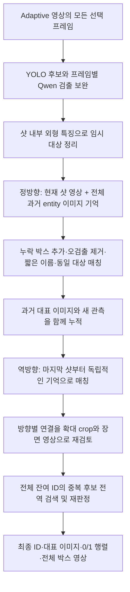

# 샷 순서대로 기억하고, 역방향으로 다시 확인하는 entity 분석

## 1. 실행 한 번으로 끝내기

```bash
cd /home/rubis/HayeonP/video_analysis/04_entity_extraction
./run.sh
```

기존 Python 환경과 GPU를 사용하는 실행 파일이다. 프레임 준비, 검출, 양방향 매칭,
최종 재검토, 대표 이미지, 샷별 등장 행렬, 전체 시각화 및 ON/OFF 비교 영상까지 자동 생성한다.
수동 ID 지정이나 후속 명령은 필요하지 않다. 작업 시간은 콘솔과 `timing.json`에 기록한다.

- 입력: `inputs/sintel_adaptive/summary.json` 및 각 샷의 `samples.json`, `sampled.mp4`.
- 기본 출력: `outputs/sintel_sequential/`.
- 기본 옵션: `--mode both --qwen-identity sequential`.
- GPU 변경: `ENTITY_CUDA_DEVICE=3 ./run.sh`.
- 다른 입력: `./run.sh --input /path/to/adaptive_root --output outputs/new_video`.
- Qwen ON만: `./run.sh --mode with_qwen --output outputs/new_video_on`.

입력은 03 단계 출력 형식이어야 한다. 임의의 MP4만 넣은 폴더는 입력 형식이 아니다.
새 입력 또는 설정 변경에는 새 출력 폴더를 쓴다. 같은 명령을 다시 실행하면 일치하는
프레임·검출·외형 특징 및 Qwen 요청 캐시를 재사용하고 최종 결과를 다시 구성한다.
캐시가 없어도 동일한 명령으로 처음부터 분석한다.

## 2. 컨셉

각 샷에 나온 대상을 정리하고, 이전에 등장했던 대상의 이미지·샷 요약·관찰 이력을 함께 비교한다.
같으면 기존 기록에 새 모습을 추가하고, 다르거나 불확실하면 별도로 남긴다.
이후 마지막 샷부터 처음 샷까지 별도의 기억을 만들면서 다시 비교한다.
두 방향의 결론과 전체 개체 목록을 마지막으로 검토해 최종 ID를 정한다.



## 3. 실제 처리 순서

### 준비: 검출 결과와 샷 내부 후보

모델을 샷마다 반복 로드하지 않도록 YOLO 후보, 프레임별 Qwen 검출 보완,
얼굴/몸/물체 특징 추출은 먼저 준비한다. 이 단계는 캐시 재사용이 가능하다.
이후 샷 내부에서만 SFace/OSNet/DINO 외형 특징으로 관측을 묶는다.
샷 경계에서 이 임시 외형 registry를 초기화하므로 여기서 샷 간 ID를 확정하지 않는다.

### 정방향: 현재 영상과 전체 과거 기억

Qwen에 전달하는 정보:

1. 현재 샷의 **모든 adaptive 선택 프레임**을 원래 순서로 구성한 영상.
2. 현재 임시 ID의 박스 및 최대 3개 crop, YOLO 후보 좌표와 프레임 ID.
3. 앞선 샷에서 누적한 **모든 entity**의 ID·짧은 이름·외형 설명·대표 crop.
4. 앞선 모든 샷의 요약과 등장 entity 연결 기록.
5. 각 entity가 샷마다 보인 모습·행동 문맥·매칭 이유 이력. 요약과 설명은 정답이 아닌 모델의 관찰 가설로 취급한다.

오래 전에 나온 대상도 목록에서 제거하지 않는다. 기억이 많아지면 이미지 페이지를 나눠
모두 전달한다. 시간 거리나 외형 top-k 때문에 초반 인물이 후보에서 탈락하지 않는다.
각 entity의 과거 관측은 유지하며 대표 이미지는 선명도·밝기·크기와 서로 다른 샷을 고려해 고른다.

Qwen은 샷 내부 조각들을 정리하고, 누락된 대상의 실제 프레임/박스를 추가할 수 있다.
추가 박스는 정규화 좌표 범위, 제공된 프레임 ID, 기존 박스와 중복 여부를 검사한다.
기존 임시 ID는 결과에 정확히 한 번 포함되거나 명시적으로 오검출로 제외되어야 한다.

매칭은 `same / new / uncertain`이다. `same`은 존재하는 기억 ID를 지정해야 한다.
같은 프레임의 서로 다른 박스가 하나의 ID로 합쳐지는 연결은 차단한다.
정방향 ID는 `F0001` 같은 임시 ID이며, 최종 출력 ID는 아직 아니다.

### 역방향: 샷 순서만 반대로

정방향에서 정리한 **샷 내부 대상과 관측**을 고정하고, 빈 기억에서 다시 시작한다.
`마지막 샷 → … → 첫 샷` 순서로 검토하며 `R0001` 등의 별도 ID를 부여한다.
정방향의 샷 간 매칭 ID/판단 이유는 역방향 Qwen 입력에 전달하지 않는다.
역방향도 자체 샷 요약과 관찰 이력을 생성해 누적한다. 정방향의 매칭 ID나 매칭 이유를 넘기지 않는다.
샷 안의 프레임은 정상 재생 순서다. 동작 자체를 거꾸로 재생하지 않는다.

독립성은 **샷 간 매칭**에 대한 것이다. 검출과 샷 내부 묶음은 양방향이 공유하므로,
두 결과가 같다고 검출 오류까지 독립적으로 검증된 것은 아니다.
역방향은 새 박스를 검출하는 단계가 아니라 동일 개체 연결을 다시 판단하는 단계다.

### 최종: 두 방향의 제안과 전체 목록 재검토

두 방향이 연결한 ID에서 연결 간선을 모은다. 이미지를 다시 보고 각 연결을 판정한다.

1. 확대 crop, 대상이 나오는 샷과 앞뒤 샷의 장면 프레임, 전체 샷 요약, 양방향의 연결 가설을 **하나의 문맥 판정**에 전달한다.
2. 일반 검토에서는 대상 샷과 인접 1개 샷에서 샷당 최대 4개 균등 프레임, 대상 관찰의 첫·중간·마지막·가장 큰 박스 프레임을 선택한다. 원본의 adaptive 샘플 범위에서만 선택한다.
3. `same`에는 구체적인 긍정 근거가 필요하다. `different`에는 양쪽 실제 대상 프레임 ID와 서로 모순되는 얼굴/신체/별개 대상의 관찰 근거가 필요하다. 얼굴이 안 보임, 어둠, 옷·조명·각도 변화는 다른 인물의 증거가 아니다.
4. `uncertain` 또는 기존 양방향 연결과 충돌하는 `different`는 인접 2개 샷·샷당 최대 7개 프레임으로 확대 재검토한다. 끝까지 불확실하면 연결을 보류한다.
5. crop만으로 영상 판단을 뒤집던 별도 거부 단계를 제거했다. 문맥 판정의 구체적 `different`와 동시 등장 제약은 간접 병합에도 적용한다.

그다음 남은 전체 entity를 페이지 쌍으로 비교해 중복 후보를 찾는다.
이때도 샷 요약과 누적 관찰 이력을 전달하며 같은 문맥 판정을 통과해야 합친다.
불확실하거나 구조화 응답 재시도가 실패한 대상은 별도로 남기고 근거 파일에 기록한다.

근거의 형식과 프레임 ID는 코드로 검사하지만, 모델이 적은 근거가 시각적으로 옳다는 사실까지
보장하지는 않는다. 동일 프레임의 중복 검출 박스가 서로 다른 대상으로 남는 문제도 별도로 발생할 수 있다.

최종 ID는 최초 등장 순서에 따라 `E0001`, `E0002`처럼 배정한다.
대표 이미지의 레이블을 최종 카탈로그와 영상에서 공통 사용한다.

## 4. 최종 산출물

```text
outputs/sintel_sequential/
  timing.json
  with_qwen/
    entities.json                   전체 entity 목록과 이미지 경로
    entities/E0001/representative.jpg
    entity_gallery.jpg              전체 대표 이미지 모음
    entity_shot_presence.csv         행=entity, 열=shot, 값=0/1
    entity_shot_presence.json        같은 행렬과 값의 의미
    shot_entities.json              샷별 등장 entity와 근거 관측 ID
    observations.json               프레임/원본 시각/박스/최종 ID
    adaptive_entities_full.mp4       전체 adaptive 영상 + 최종 박스/ID
    video_validation.json            시각과 영상 길이 검증
    result_validation.json           등장 행렬·관측·양방향/최종 매핑 검사
    RESULT_REPORT.md                 수치·방향별 차이·불확실 검토 자동 리포트
    sequential/
      forward.json                  정방향 임시 매핑과 기억
      reverse.json                  역방향 임시 매핑과 기억
      direction_comparison.json     방향별 일치·불일치 ID 쌍
      final_mapping.json            샷 내부 ID → 정/역방향 ID → 최종 ID
      summary.json
      forward/shot_*/               샷별 요청 자료, 응답, 갱신된 기억
      reverse/shot_*/
      final/                        전역 후보와 개별 최종 판정 근거
  without_qwen/                     YOLO + 외형 매칭 기준선 및 같은 산출물
  qwen_comparison_full.mp4          왼쪽 OFF / 오른쪽 ON
  comparison_summary.json
```

`presence[e,s] = 1`은 최종 ID `e`의 관측이 샷 `s`에서 하나 이상 있다는 뜻이다.
`0`은 분석한 샘플에서 확인하지 못했다는 뜻이다. 원본의 미선택 프레임에도 절대 없다는
의미는 아니다. ID가 병합되면 모든 관측에서 행렬을 다시 계산하므로 기존 행의 OR와 같다.

정·역방향 일치율은 “같다고 묶은 ID 쌍” 집합의 교집합/합집합(Jaccard)이다.
다른 ID인 경우의 수가 많아서 수치가 부풀려지는 전체 쌍 단순 일치율은 사용하지 않는다.
이 값은 정답 정확도가 아니라 두 진행 방향의 일관성을 나타낸다.

## 5. 시간, 캐시와 한계

`timing.json`은 현재 실행의 실제 경과 시간이다. 검출/특징 캐시가 있으면 그 단계의 추론은
건너뛰므로 최초 실행 시간과 다르다. 명시적 캐시 재사용 예시:

```bash
./run.sh --reuse-qwen outputs/sintel_temporal/with_qwen \
  --output outputs/sintel_sequential
```

기존 검출은 재사용하더라도 새로운 기억·양방향·최종 검토 요청은 해당 입력과 일치하는
응답 캐시가 없는 한 새로 추론한다. 새 영상에 예전 영상의 검출 캐시는 사용할 수 없다.

최종 검토는 보수적으로 합치므로 같은 대상이 여러 ID로 남을 수 있다. 흐린 얼굴,
애니메이션, 몸이 겹친 crop, 샷 내부의 잘못된 묶음은 여전히 제한이다.
현재 구조는 샷 내부에 이미 섞인 한 임시 ID를 여러 개체로 분해하는 기능은 없다.
전역 페이지 쌍 검토는 ID가 많아질수록 비용이 증가한다. 대상 수가 매우 많은 장편 영상은
별도의 검색/메모리 용량 전략이 필요하다.

원본 시각과 adaptive 유지 구간은 그대로 보존한다. 결과 영상은 무음이며,
박스의 유지 구간은 adaptive 이미지 표시 구간이지 원본 미선택 프레임의 검출 증거는 아니다.

## 6. 이전 v1 Sintel 실행 확인 기록 — 2026-10-06

기본 명령 `./run.sh`를 실제 실행해 전체 자동 처리를 완료했다.

| 항목 | 결과 |
|---|---:|
| 샷 / adaptive 선택 프레임 | 17 / 279 |
| 원본 시간 격자의 총 프레임 / 길이 | 1,253 / 52.208333초 |
| Qwen ON 관측 / 최종 entity | 169 / 45 |
| Qwen OFF 관측 / 최종 entity | 144 / 50 |
| 정방향 / 역방향 임시 ID | 62 / 42 |
| 양방향의 동일 개체 쌍 일치율 | 약 8.3% |
| 최종 전체 실행 시간 | 25분 51.07초 |

검출·외형 특징 캐시를 재사용한 실행 시간이며, 초기 개발과 중단한 실행의 시간은 포함하지 않는다.
두 모드 모두 샘플 PTS·영상 길이·유지 구간 보존, 등장 행렬과 관측의 일치,
대표 이미지 존재 검사를 통과했다. ON은 정·역방향의 샷 내부 ID 커버리지와 최종 매핑도 검사했다.

**구조 검증 통과는 동일 개체 매칭의 정답 검증이 아니다.**
결과 이미지 확인에서 같은 여성의 초반 겨울 복장은 `E0002`, 중반 모습은 `E0005`,
후반 일부 모습은 `E0016`으로 여전히 분리되어 있다. `E0001` 등 추가 조각도 남는다.
이 ID를 사람이 강제로 합치지는 않았다. 정방향 기억을 늘리고 역방향으로 재검토해도
현재 Qwen 4B와 검출/crop의 한계 때문에 자동 매칭 정확도가 충분히 확보되지는 않았다.
동작 자동화와 시간축·파일 일관성은 확인했지만, 여성의 완전한 통합 문제는 남아 있다.

이 예시는 해당 실행 결과의 점검 기록이다. 다음 실행의 ID가 항상 같은 물리적 대상을 뜻한다는
규칙이나 모델 입력의 정답 정보로 사용하지 않는다.


## 7. v2 수정 및 검증 (2026-10-06)

`sequential_identity_version=2`부터 위 문맥 전달과 통합 판정을 사용한다.
이 문서의 과거 실행 수치는 v1 결과이며 v2 전체 분석 결과가 아니다.
테스트 내용과 실제 Qwen 판정은 [수정·테스트 보고서](CONTEXT_FIX_REPORT.md)에 기록했다.

캐시를 직접 초기화하려면:

```bash
python3 clear_cache.py          # 대상 목록만 보기
python3 clear_cache.py --apply  # 04 outputs의 추론·중간 캐시와 기존 실행 설정 삭제
./run.sh
```

입력 영상, 다운로드된 모델 가중치, 최종 카탈로그·대표 이미지·영상은 유지한다.
기존 결과는 재실행이 끝날 때까지 이전 버전의 결과다. 실행 중인 분석의 잠금을 확보할 수 없으면
캐시 삭제를 중단한다. `CACHE_CLEAR_REPORT.json`에 삭제 목록을 저장한다.
