# 3R Video 동작 구조 — 번호별 설명

**영상 전체를 5초 윈도우·1초 간격으로 훑고, 1.5fps에서 찾은 이벤트 후보 주변을 4fps로 다시 분석한다.** 사람·캐릭터·동물·물체에는 영상 전체에서 사용하는 대상 ID를 연결한다.

그림과 설명 표에서 **같은 번호는 같은 동작**을 뜻한다. 예를 들어 “5번에서 프레임 번호를 어떻게 고르는가?”, “11번에서 무엇을 저장하는가?”처럼 번호로 지칭하면 된다. 아래는 현재 코드의 기본 설정으로 처음 실행할 때의 순서다.

```mermaid
flowchart TB
    N01["1. 실행 환경 준비<br/>프로젝트 .venv 자동 사용"]
    N02["2. 영상과 실행 기록 확인<br/>영상 정보 · 설정 · 체크포인트 읽기"]
    N01 --> N02

    subgraph COARSE["1차 분석: 영상 전체에서 후보 찾기"]
        N03["3. 윈도우 목록 만들기<br/>0~5초 → 1~6초 → 2~7초 …"]
        N04["4. 1.5fps 샘플링과 이미지 저장<br/>약 8장 / 5초 · 실제 시간 기록"]
        N05["5. Qwen으로 윈도우 내용 분석<br/>대상 · 행동 · 이벤트 시간 · 근거 프레임 번호 출력"]
        N06["6. 모델 출력 검증<br/>JSON 형식 · ID 참조 · 시간 · 프레임 번호 확인"]
        N07["7. Qwen으로 대상 위치 검출<br/>선택 프레임에서 검출 · 미검출 시 다른 샘플 프레임 확인"]
        N08["8. 대상 영역 자르기<br/>동일성 비교용 crop 이미지 만들기"]
        N09["9. 전역 대상 ID 연결<br/>기존 대상과 비교 · 새 ID 등록 · 관찰 기록 갱신"]
        N10["10. 유의미한 후보 필터<br/>이벤트 종류 · 불확실성 · 상태 변화로 유지 여부 결정"]
        N11["11. 이벤트에 시간 · ID · 근거 연결<br/>원본 시간과 전역 ID 적용 · 저장된 프레임 경로 연결"]
        N12["12. 1차 윈도우 처리 상태 저장<br/>진행 위치 · 이벤트 · 대상 목록 · 실패 기록"]
        N03 --> N04 --> N05 --> N06 --> N07 --> N08 --> N09 --> N10 --> N11 --> N12
        N12 -->|다음 윈도우가 있으면| N04
    end

    subgraph SELECT["재분석 구간 선택"]
        N13["13. 1차 중복 이벤트 병합<br/>겹치는 윈도우의 같은 행동 묶기"]
        N14["14. 재분석할 시간 구간 만들기<br/>후보 전후 1초 확장 · 겹침 병합 · 최대 5초로 나누기"]
        N13 --> N14
    end

    subgraph REFINE["2차 분석: 선택한 구간을 4fps로 재분석"]
        N15["15. 원본에서 4fps 샘플링과 저장<br/>약 20장 / 5초 · 새 입력 프레임 묶음"]
        N16["16. 선택 구간 정밀 분석<br/>4fps 입력과 후보 힌트로 5~11번 절차 재수행"]
        N17["17. 2차 윈도우 처리 상태 저장<br/>진행 위치 · 재분석 이벤트 · 대상 목록 · 실패 기록"]
        N15 --> N16 --> N17
        N17 -->|다음 재분석 구간이 있으면| N15
    end

    subgraph FINAL["영상 전체 결과 정리"]
        N18["18. 보류된 대상 ID 연결 재검토<br/>통합된 ID를 2차 이벤트에 반영"]
        N19["19. 최종 이벤트 병합과 정렬<br/>2차 결과 + 재분석 실패 시 1차 후보 보존"]
        N20["20. 결과 파일 저장<br/>timeline.json · entities.json · events.csv · timeline.html"]
        N18 --> N19 --> N20
    end

    N02 --> N03
    N12 -->|1차 윈도우를 모두 처리하면| N13
    N14 -->|재분석 구간이 있으면| N15
    N14 -->|재분석 구간이 없으면| N18
    N17 -->|2차 윈도우를 모두 처리하면| N18

    classDef program fill:#f1f5f9,stroke:#64748b,color:#0f172a;
    classDef model fill:#dbeafe,stroke:#2563eb,color:#172554;
    classDef decision fill:#fef3c7,stroke:#d97706,color:#78350f;
    classDef saved fill:#dcfce7,stroke:#16a34a,color:#14532d;
    class N01,N02,N03,N04,N06,N08,N15 program;
    class N05,N07,N16 model;
    class N09,N10,N13,N14,N18,N19 decision;
    class N11,N12,N17,N20 saved;
```



**4~12번을 윈도우마다 반복한 뒤 13번으로 넘어간다.** 이후 **15~17번을 선택한 재분석 구간마다 반복한 뒤 18번으로 넘어간다.** 16번은 5~11번과 같은 처리 절차를 4fps 프레임에 적용한다. 따라서 “16번의 위치 검출”은 2차 분석에서 수행하는 7번 동작이다.

**기본 실행은 구간 분석에 실패해도 기록하고 다음 구간으로 진행한다.** 5~6번에서 유효한 분석 결과를 얻지 못하면 해당 윈도우를 건너뛰고 12번에서 실패와 다음 순번을 저장한다. 7~9번만 실패하면 이미 얻은 이벤트를 대상 미확인으로 남긴다. 16번의 분석 자체가 실패해도 17번에서 다음 재분석 윈도우로 넘어가며, 19번에서 해당 구간의 1차 후보를 불확실한 결과로 보존한다. 실패 내역은 `analysis_errors.json`과 최종 타임라인에 포함된다. 실행 시작 자체가 불가능한 입력·설정 오류, 저장 불가, 사용자의 중단은 예외다.

파란색은 Qwen 호출이 포함된 분석, 주황색은 선별·비교·병합, 초록색은 결과 연결·저장이다. 9번과 18번의 대상 이미지 비교에도 필요하면 Qwen을 호출한다. Qwen3-VL-4B-Instruct 모델 하나를 GPU에 로드해 비디오 분석·위치 검출·이미지 비교에 재사용한다. 모델은 NF4 4bit로 실행하며 vision 모듈과 출력 헤드는 원래 정밀도를 유지한다.

## 1~12번: 준비와 1차 윈도우 분석

| 번호 | 입력 | 구체적으로 하는 동작 | 출력 |
| --- | --- | --- | --- |
| **1. 실행 환경 준비** | `./run.sh analyze …` 또는 `python3 run.py analyze …` | 프로젝트의 `.venv/bin/python`으로 실행한다. 환경이 없거나 설치 구성이 바뀌면 `setup.sh`로 생성·설치한다. | 프로젝트 가상환경에서 실행되는 분석 프로그램 |
| **2. 영상과 실행 기록 확인** | 원본 영상, 설정, 출력 폴더 | 영상 길이·해상도·원본 fps를 읽는다. 입력 파일 해시·설정·분석 길이를 기록하거나 기존 기록과 대조하고, 체크포인트가 있으면 진행 상태를 복원한다. | 영상 정보, 실행 설정, 이전 이벤트와 대상 목록, 재개 위치 |
| **3. 윈도우 목록 만들기** | 분석할 영상 길이 | 시작점을 1초씩 옮기며 최대 5초 구간을 만든다. 예: `0~5`, `1~6`, `2~7`초. 마지막 구간은 영상 끝에 맞춘다. | `(시작 시간, 끝 시간)` 목록. 이 단계에서 별도 MP4 파일은 만들지 않는다. |
| **4. 1.5fps 샘플링과 저장** | 현재 윈도우에 해당하는 원본 영상 | 약 0.667초 간격으로 프레임을 선택하고 크기를 조정한다. 디코딩한 실제 시간을 보존하며 프레임 이미지를 `frames/`에 저장한다. | 약 8장의 프레임/5초, 프레임 번호·시간 대응표, 이미지 경로 |
| **5. Qwen 윈도우 내용 분석** | 4번의 프레임 묶음과 시간표, 기존 대상 설명, 최근 이벤트 문맥 | 프레임들을 **하나의 비디오 입력으로 함께** 보고 대상의 종류·외형, 행동 설명, 이벤트 시작·끝, 전후 상태를 JSON으로 출력한다. 이벤트별 `evidence_frames`에는 관련 입력 프레임 번호를 지정한다. 대상별로 위치 확인에 쓸 대표 프레임 번호와 초기 bbox도 출력한다. | 현재 윈도우의 임시 대상 목록, 이벤트 후보, 관련 프레임 번호, 컷 전환 시간. 대상 ID와 이벤트 시간은 아직 윈도우 기준이다. |
| **6. 모델 출력 검증** | 5번의 응답 | JSON 형식, 필수 필드, 대상 ID 참조, bbox, 프레임 번호, 시간 범위를 검사한다. 실패하면 같은 입력과 오류 내용을 주고 기본 1회 재시도하며, 다시 실패하면 오류를 기록하고 해당 윈도우를 건너뛴다. | 구조 검증을 통과한 분석 결과 또는 실패 기록. 내용이 영상과 사실상 일치하는지까지 판정하는 단계는 아니다. |
| **7. Qwen 대상 위치 검출** | 5번에서 발견한 대상 목록과 각 대상의 대표 프레임 | 같은 대표 프레임에 있는 대상들을 묶고, **해당 이미지와 대상 설명을 Qwen에 다시 입력**해 bbox를 구한다. 대상을 찾지 못해 빈 목록이 나오는 것은 허용한다. 미검출 대상만 같은 윈도우의 다른 샘플 프레임에서 뒤쪽부터 확인한다. 위치 검출의 JSON 재시도도 실패하면 다음 프레임에서 다시 시도한다. 다른 실행 오류가 발생하면 오류를 기록하고 이벤트를 대상 미확인 상태로 넘긴다. | 찾은 대상의 bbox와 갱신된 대표 프레임 번호. 끝까지 못 찾은 대상은 확인되지 않은 5번 bbox로 대체하지 않는다. |
| **8. 대상 영역 자르기** | 7번에서 위치를 확인한 대상의 bbox와 샘플 프레임 | 확인한 bbox 영역을 잘라 대상 비교용 이미지를 만든다. 미검출 대상의 crop은 만들지 않는다. | 캐릭터·물체 등의 crop 이미지. 11번의 이벤트 근거용 전체 프레임과 용도가 다르다. |
| **9. 전역 대상 ID 연결** | 새 crop·외형 설명·프레임 시간·bbox, 지금까지 누적한 대상 목록 | 동일 원본 프레임에서 위치가 거의 일치하는 기존 대상이 있으면 연결한다. 그 외에는 종류 등이 맞는 기존 대상의 대표 이미지들을 Qwen으로 비교한다. 연결되면 기존 ID를 쓰고, 연결되지 않으면 새 ID를 만든다. 애매하면 가능한 연결 후보를 남긴다. crop과 관찰 기록도 저장한다. | `local_id → entity_0001` 같은 매핑, 갱신된 대상 목록과 대표 이미지. 비교 대상은 이전 한 윈도우에만 한정되지 않는다. |
| **10. 유의미한 후보 필터** | 5번에서 나온 이벤트 후보 | 아래 규칙으로 유지 여부를 결정한다. 추가 Qwen 호출은 없다. | 유지할 이벤트 후보. 제외한 후보도 원래 윈도우 분석 JSON에는 남아 있다. |
| **11. 시간·ID·근거 연결** | 10번을 통과한 후보, 9번의 ID 매핑, 4번의 저장된 프레임 | 이벤트 상대 시간에 윈도우 시작 시간을 더하고, 임시 대상 ID를 전역 ID로 바꾼다. 이벤트 시간 안의 모든 샘플 프레임 + 같은 윈도우의 직전·직후 각 1장 + 모델이 지정한 프레임을 합쳐 경로와 시간을 연결한다. 중복 프레임은 한 번만 넣는다. | 원본 시간·전역 대상 ID·`evidence`가 붙은 이벤트. **이 단계에서는 새 이미지를 만들거나 추가 샘플링하지 않는다.** |
| **12. 1차 처리 상태 저장** | 현재 윈도우의 이벤트·대상 목록·실패 기록 | 이벤트와 오류를 누적하고 다음 윈도우 위치와 대상 목록을 `checkpoint.json`에 저장한다. 실패로 건너뛴 윈도우도 다음 순번으로 이동한다. 다음 윈도우가 있으면 4번을 반복한다. | 정상 처리와 실패 기록을 포함해 복구할 수 있는 상태. 전체 1차 분석이 끝나면 13번으로 진행한다. |

**10번의 현재 필터 규칙**은 다음과 같다. 중요도 점수를 계산하는 방식은 아니다.

- `event_type`이 `ongoing`이 아니면 유지한다. 등장·사라짐·행동·상호작용·상태 변화가 여기에 해당한다.
- `ongoing`이라도 `uncertain = true`이면 유지한다.
- `ongoing`이라도 `state_before`와 `state_after`가 모두 있고 두 값이 다르면 유지한다.
- 나머지 `ongoing` 후보는 제외한다.

## 5번에서 추론하는 것과 출력의 단위

**5번의 입력은 한 윈도우의 프레임 시퀀스와 시간표이며, 출력은 윈도우 전체의 대상 목록과 이벤트 목록을 담은 JSON 하나다.** 아래 항목들은 한 번의 비디오 분석 응답에 함께 들어간다.

| 추론하는 내용 | 결과 필드 | 결과의 단위 |
| --- | --- | --- |
| 이 윈도우에 어떤 서로 다른 대상들이 보이는가? 여러 프레임의 대상이 같은 대상인가? | `entities[].local_id`, `kind`, `label`, `appearance` | 윈도우 안의 서로 다른 대상마다 한 항목. 같은 대상은 프레임이 달라도 같은 로컬 ID를 쓰도록 요청한다. |
| 그 대상을 어느 프레임의 어느 위치에서 볼 수 있는가? | `entities[].frame_index`, `bbox` | 대상당 선택 프레임 한 장의 위치. 모든 프레임에서의 위치 목록은 아니다. |
| 누가 무엇을 어떻게 했고, 언제 상태가 바뀌었는가? | `events[].actor_id`, `object_id`, `action`, `description`, `start_sec`, `end_sec`, `state_before`, `state_after` | 이벤트 발생 건마다 한 항목. 시간은 윈도우 상대 시간이다. |
| 어떤 입력 프레임이 그 이벤트를 뒷받침하는가? | `events[].evidence_frames` | 이벤트별 프레임 번호 목록. 대상별 bbox 목록은 아니다. |
| 장면의 컷 전환은 언제인가? | `scene_cuts_sec` | 윈도우 상대 시간 목록 |

`entities`와 `events`는 **ID로 연결**된다. 예를 들어 `entities`에 `e1 = 빨간 옷의 캐릭터`, `e2 = 파란 상자`가 있으면, `actor_id: e1`, `object_id: e2`, `action: pick_up`인 이벤트는 그 캐릭터가 그 상자를 집어 들었다는 뜻이다. 같은 `e1`과 `e2`가 여러 이벤트에 참여할 수 있다. 이벤트에 참여하지 않는 대상도 대상 목록에 있을 수 있다. 6번에서는 이벤트가 참조한 ID가 대상 목록에 실제로 있는지 검사한다.

**대상 자체(entity)와 프레임에서의 관찰(observation)은 구분해야 한다.** 같은 캐릭터가 F2·F3·F4에 보이면 대상은 하나이고, 프레임별 관찰은 세 개다. 현재 출력은 이 세 관찰을 모두 저장하는 형식이 아니라, 대상 하나에 선택 프레임의 위치 하나를 붙이는 형식이다.

프레임별 위치까지 표현하려면 아래처럼 별도의 관찰 목록이 필요하다. 다음 `observations`는 **현재 구현에 없는 출력 구조를 설명하는 예시**다.

```json
{
  "observations": [
    {"local_id": "e1", "frame_index": 2, "bbox": [100, 200, 300, 800]},
    {"local_id": "e1", "frame_index": 3, "bbox": [150, 200, 350, 800]},
    {"local_id": "e1", "frame_index": 4, "bbox": [200, 200, 400, 800]}
  ]
}
```

7번은 5번이 선택한 프레임에서 먼저 위치를 구하고, 실패하면 같은 윈도우의 다른 샘플 프레임으로 대표 프레임을 바꿀 수 있다. 대상당 확인된 위치 하나를 구하는 것이므로 프레임별 이동 경로를 만들지는 않는다. 끝까지 위치가 확인되지 않은 대상이 참여한 이벤트는 `uncertain: true`, `review_reason: unlocalized_entities`, `unresolved_local_ids`로 표시한다. 해당 대상의 전역 ID는 연결하지 않으며, 이런 이벤트끼리는 ID가 비어 있다는 이유로 병합하지 않는다. 원래 대상 설명과 ID는 윈도우 분석 JSON에 남는다. **윈도우 안에서 같은 대상을 묶는 판단은 5번의 Qwen 출력에 포함되고, 서로 다른 윈도우의 대상을 전역 ID로 연결하는 작업은 9번에서 수행한다.**

## 13~17번: 재분석 구간 선택과 4fps 분석

| 번호 | 입력 | 구체적으로 하는 동작 | 출력 |
| --- | --- | --- | --- |
| **13. 1차 중복 이벤트 병합** | 모든 1차 윈도우의 유지된 이벤트 | 같은 행위자 ID·대상 물체 ID·정규화한 행동 이름을 가진 이벤트끼리 시간 겹침과 연속성을 비교해 병합한다. 같은 윈도우에서 별개로 추출된 행동은 각각 보존한다. | 중복을 정리한 `candidates.json` |
| **14. 재분석 구간 만들기** | 13번의 이벤트 시간 구간 | 각 이벤트의 전후를 기본 1초씩 확장하고 영상 범위 안으로 제한한다. 겹치는 구간을 합친 뒤 긴 구간은 최대 5초씩 나눈다. 기본 시작점 간격은 **4초**, 즉 인접한 5초 구간끼리 1초 겹친다. | `refinement_plan.json`의 재분석 구간 목록. 후보가 없으면 목록도 비어 있다. |
| **15. 4fps 샘플링과 저장** | 14번에서 선택한 현재 구간의 원본 영상 | 원본을 다시 읽어 약 0.25초 간격으로 샘플링하고 프레임을 저장한다. 1.5fps 프레임을 복제하거나 보간하는 동작이 아니다. | 약 20장의 프레임/5초, 실제 시간표와 이미지 경로 |
| **16. 선택 구간 정밀 분석** | 15번의 프레임 묶음, 해당 구간의 1차 후보 설명·시간·대상 ID, 누적 대상 문맥 | **5 → 6 → 7 → 8 → 9 → 10 → 11번을 다시 수행한다.** Qwen에 후보를 힌트로 주고 실제 프레임을 보며 행동·상태 변화·시간을 다시 추출하도록 한다. 위치 검출, crop, 대상 ID 연결, 후보 필터, 근거 연결도 새 결과에 적용한다. | 4fps 관찰을 바탕으로 새로 추출한 이벤트와 근거 프레임. 1차 결과를 그대로 복사하지 않는다. |
| **17. 2차 처리 상태 저장** | 현재 재분석 구간의 이벤트·대상 목록·실패 기록 | 2차 결과와 오류, 다음 재분석 위치를 체크포인트에 저장한다. 실패해도 다음 순번으로 이동한다. 다음 구간이 있으면 15번을 반복한다. | 처리한 2차 구간까지의 진행 상태. 모두 끝나면 18번으로 진행한다. |

**11번의 “직전·직후 프레임 연결”과 14번의 “전후 1초 확장”은 서로 다른 동작이다.** 11번은 이미 뽑아 둔 이미지 중에서 참조를 고른다. 14번은 나중에 원본에서 4fps로 새로 샘플링할 시간 범위를 정한다.

## 18~20번: 전체 타임라인 정리

| 번호 | 입력 | 구체적으로 하는 동작 | 출력 |
| --- | --- | --- | --- |
| **18. 보류된 대상 연결 재검토** | 누적 대상 목록과 2차 이벤트 | 동일성 연결을 보류한 `provisional` 대상을 대표 이미지로 다시 비교한다. 연결이 확정되면 ID를 통합하고 2차 이벤트의 행위자·물체 ID를 최종 ID로 바꾼다. 같은 윈도우에서 서로 다른 대상으로 구별했던 쌍은 통합하지 않도록 기록을 사용한다. | 최종 대상 목록과 통합 ID를 반영한 2차 이벤트 |
| **19. 최종 이벤트 병합·정렬** | 18번의 ID를 적용한 2차 이벤트, 재분석 실패 구간과 겹치는 1차 후보 | 13번과 같은 병합 기준으로 중복을 정리하고 원본 시간순으로 정렬한다. `event_00001` 형태의 이벤트 ID를 부여한다. 재분석 실패 구간의 1차 후보는 `stage: coarse`, `uncertain: true`, `review_reason: refinement_failed`로 보존한다. 이 후보는 정상 2차 결과와 병합하지 않는다. | 최종 이벤트 목록. 정상 2차 결과와 실패로 보존한 1차 후보를 구분할 수 있다. |
| **20. 결과 파일 저장** | 영상 정보, 최종 이벤트, 대상 목록, 컷 전환 시간, 분석 오류 | JSON·CSV·HTML을 출력하고 체크포인트에 완료 상태를 기록한다. 오류가 있으면 최종 `video.analysis_status`를 `complete_with_errors`로 표시한다. | `timeline.json`, `entities.json`, `events.csv`, `timeline.html`, `analysis_errors.json` |

재분석할 후보가 없으면 15~17번을 건너뛰며 최종 이벤트 목록은 비어 있다. `timeline.html`에서는 원본 영상과 이벤트·근거 이미지를 함께 보고, 이벤트 시간을 눌러 해당 위치로 이동할 수 있다.

## 4번 → 5번 → 10번 → 11번 예시

다음은 실제 분석 결과가 아닌 **동작 설명용 예시**다. 원본 **10~15초 윈도우**에서 캐릭터가 물체를 집는 상황을 가정한다. 아래 프레임 시간은 보기 쉽게 근삿값을 썼으며 실제 실행에서는 디코딩한 시간을 사용한다.

**4번 — 이미지를 먼저 저장한다.** 프레임 번호는 현재 윈도우 안에서 0부터 매긴다.

| 입력 프레임 번호 | 원본 시간 | 윈도우 상대 시간 |
| --- | --- | --- |
| F0 | 10.000초 | 0.000초 |
| F1 | 10.667초 | 0.667초 |
| F2 | 11.333초 | 1.333초 |
| F3 | 12.000초 | 2.000초 |
| F4 | 12.667초 | 2.667초 |
| F5 | 13.333초 | 3.333초 |
| F6 | 14.000초 | 4.000초 |
| F7 | 14.667초 | 4.667초 |

**5번 — Qwen이 이 프레임 묶음을 보고 이벤트와 관련 프레임 번호를 출력한다.** 예를 들어 아래는 이벤트 후보 필드 일부다.

```json
{
  "event_type": "interaction",
  "action": "pick_up",
  "description": "캐릭터가 탁자 위의 물체를 집어 든다",
  "start_sec": 2.0,
  "end_sec": 3.0,
  "evidence_frames": [3, 4]
}
```

`[3, 4]`는 **입력으로 줬던 F3·F4를 가리키는 번호**다. 새로운 근거 이미지를 생성하라는 뜻이 아니다. 이벤트 시간도 별도 필드로 출력하므로 `[3, 4]` 자체가 이벤트 시작·끝 시간인 것은 아니다. 이어서 6~9번에서 출력 검증·위치 검출·crop·대상 ID 연결을 수행한다.

**10번 — 이 후보는 `interaction`이므로 유지한다.**

**11번 — 유지된 이벤트에 기존 프레임 참조를 연결한다.**

- 이벤트 구간 안의 샘플: F3, F4
- 이벤트 직전·직후의 샘플: F2, F5
- 모델이 지정한 샘플: F3, F4
- 중복 제거 후 최종 근거: **F2, F3, F4, F5의 저장 경로와 원본 시간**

이벤트 시간은 윈도우 시작 시간 10초를 더해 **원본 12~13초**가 된다. 이후 14번에서는 이 후보를 전후 1초 확장해 **11~14초**를 재분석 대상으로 잡는다. 다른 후보와 겹치면 구간을 합칠 수 있고, 실제 4fps 프레임 추출은 15번에서 수행한다.

## 번호별 코드와 저장 위치

아래 경로 중 결과 파일은 모두 지정한 출력 폴더 기준이다.

| 관련 번호 | 구현 파일 | 저장 결과 |
| --- | --- | --- |
| 1 | [run.py](run.py), [setup.sh](setup.sh) | 프로젝트 `.venv/` |
| 2, 12, 17 | [pipeline.py](src/video_events/pipeline.py) | `manifest.json`, `checkpoint.json` |
| 3, 4, 15 | [video.py](src/video_events/video.py) | `frames/` |
| 5, 6, 7, 16의 Qwen 분석 | [backend.py](src/video_events/backend.py), [prompts.py](src/video_events/prompts.py), [schema.py](src/video_events/schema.py) | `windows/`, `model_calls/` |
| 8, 9, 18 | [identity.py](src/video_events/identity.py) | `entities/`, 대상 목록은 체크포인트와 최종 `entities.json`에 저장 |
| 10, 11, 13, 14, 19 | [events.py](src/video_events/events.py) | `candidates.json`, `refinement_plan.json`; 이벤트 근거는 체크포인트와 최종 결과에 포함 |
| 20 | [export.py](src/video_events/export.py), [pipeline.py](src/video_events/pipeline.py) | `timeline.json`, `entities.json`, `events.csv`, `timeline.html`, 완료 체크포인트 |

그림은 처리 순서를 보여준다. 중단 후 같은 명령을 다시 실행하면 완료한 윈도우를 체크포인트로 건너뛰며, 처리 중이던 윈도우의 분석·위치 검출 결과 파일이 있으면 재사용한다. 각 결과가 저장되는 구체적인 위치는 위 표를 참조하면 된다.

## 샘플 영상 실행

```bash
./run.sh analyze videos/sintel_trailer_1080p.mp4 --output outputs/sintel
```

가상환경은 자동으로 적용된다. 실행 결과는 `outputs/sintel/`에 저장되고, `outputs/sintel/timeline.html`에서 확인할 수 있다. 기본 설정은 [config.example.json](config.example.json), 설치와 상세 사용법은 [README.md](README.md)에 정리되어 있다.
